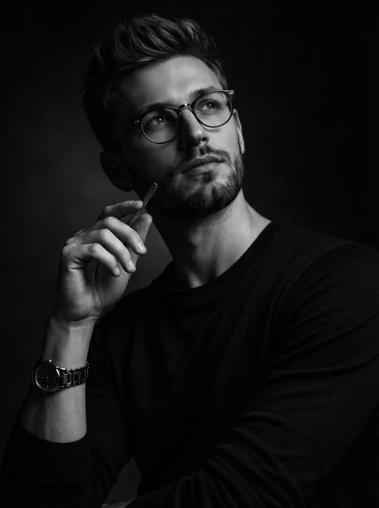

# Aijaz — by @iamsofiaijaz

[← Back to Examples from X](../../EXAMPLES.md) · Category: Photography · Model: `Nano Banana`

<a href="https://x.com/iamsofiaijaz/status/2009980871760400568"></a>

Original post: **[@iamsofiaijaz on X](https://x.com/iamsofiaijaz/status/2009980871760400568)** · Creator: [Aijaz](https://x.com/iamsofiaijaz)

## Prompt

```text
A dramatic black and white studio portrait of a thoughtful man with short styled hair, light stubble beard, and round eyeglasses, wearing a simple black sweater and a metal wristwatch, holding a pencil near his face, looking slightly upward and to the side, soft Rembrandt lighting from the left, deep shadows, high contrast, dark background, shallow depth of field, cinematic mood, ultra detailed, sharp focus, 85mm lens, f/1.8, professional photography, editorial portrait, minimalistic, moody, fine art photography
```

## Try it

Paste the prompt into **[vinano.ai](https://vinano.ai?utm_source=github&utm_medium=readme&utm_campaign=awesome-image-video-prompts-updating&utm_content=x-page-try)** to generate your own version.

> The image and prompt belong to [@iamsofiaijaz](https://x.com/iamsofiaijaz) and are shown here with credit for reference. Creators can ask for changes or removal by opening an issue.
