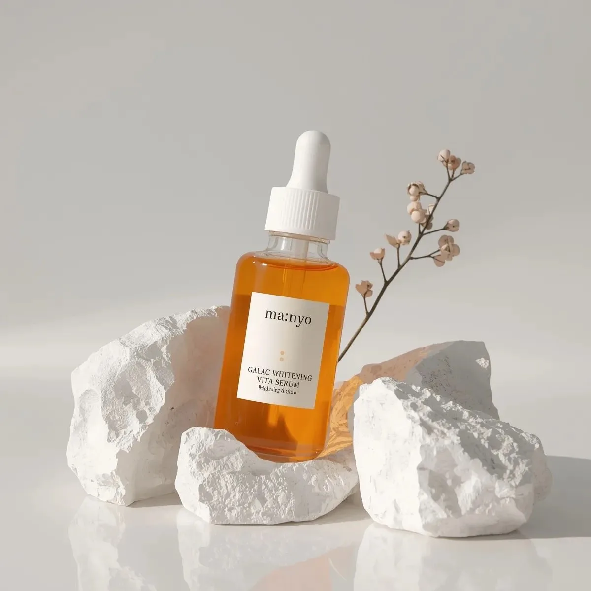

# Kashberg — by @Kashberg_0

[← Back to Community Examples](../../EXAMPLES.md) · Category: Product & Brand · Model: `Nano Banana`

<a href="https://x.com/Kashberg_0/status/2026270010814136482"></a>

Source: **[@Kashberg_0 on X](https://x.com/Kashberg_0/status/2026270010814136482)** · Creator: [Kashberg](https://x.com/Kashberg_0)

## Prompt

```text
Minimalist studio product photography of an amber glass dropper serum bottle with white cap, labeled “ma:nyo Galac Whitening Vita Serum”, placed between large textured white stones, soft beige background, warm sunlight casting natural shadows, subtle golden glow reflecting through the glass, small delicate dried flowers beside the bottle, glossy reflective surface, high-end skincare advertisement, ultra-realistic, 85mm lens, shallow depth of field, soft diffused lighting, clean aesthetic, 8k resolution.
```

## Try it

Paste the prompt into **[vinano.ai](https://vinano.ai?utm_source=github&utm_medium=readme&utm_campaign=awesome-image-video-prompts-updating&utm_content=x-page-try)** to generate your own version.

> The image and prompt belong to @Kashberg_0 ([original post](https://x.com/Kashberg_0/status/2026270010814136482)) and are shown here with credit for reference. Creators can ask for changes or removal by opening an issue.
