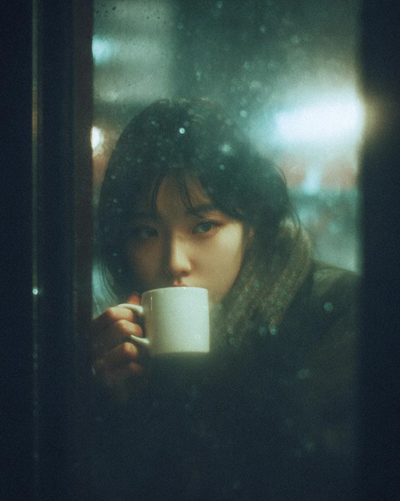

# Oogie — by @oggii_0

[← Back to Examples from X](../../EXAMPLES.md) · Category: Photography · Model: `Nano Banana`

<a href="https://x.com/oggii_0/status/2015378809508503595"></a>

Original post: **[@oggii_0 on X](https://x.com/oggii_0/status/2015378809508503595)** · Creator: [Oogie](https://x.com/oggii_0)

## Prompt

```text
A cinematic, moody photograph of a young woman sitting inside a café at night, seen through a rain-covered window. Raindrops and condensation blur the glass, creating a dreamy, nostalgic atmosphere. She has soft features, dark hair with bangs, and is holding a small white ceramic mug close to her face, sipping a warm drink. Warm interior light contrasts with cool teal and blue city lights outside. Shallow depth of field, soft focus, film grain, muted colors, melancholic mood, intimate composition, reflective glass, bokeh lights in the background, realistic photography, 35mm film look, low light, cinematic color grading.
```

## Try it

Paste the prompt into **[vinano.ai](https://vinano.ai?utm_source=github&utm_medium=readme&utm_campaign=awesome-image-video-prompts-updating&utm_content=x-page-try)** to generate your own version.

> The image and prompt belong to [@oggii_0](https://x.com/oggii_0) and are shown here with credit for reference. Creators can ask for changes or removal by opening an issue.
