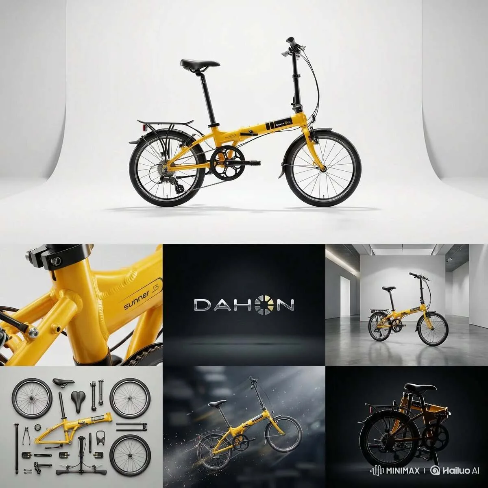

# Firat Bilal — by @firatbilal

[← Back to Examples from X](../../EXAMPLES.md) · Category: Product & Brand · Model: `Nano Banana`

<a href="https://x.com/firatbilal/status/2033941378279883011"></a>

Original post: **[@firatbilal on X](https://x.com/firatbilal/status/2033941378279883011)** · Creator: [Firat Bilal](https://x.com/firatbilal)

## Prompt

```text
CORE OBJECTIVE: Create a professional 8k studio editorial based on [ATTACHED_INPUT_IMAGE]. Analyze subject geometry, material, and branding to maintain logic across 7 seamless panels.

STEP 1: DYNAMIC ANALYSIS
Identify: Subject, logo (or name), and material.

Material Logic: Tech (sharp rim lights), Glass (refraction/caustics), Organic (soft light), Fashion (matte/satin sheen).

COMPOSITION & STRUCTURE
Single seamless image. Top: 1 Hero Panel. Bottom: 2x3 Grid (6 panels). Total 7 views. No text or borders (except Frame 2).

PANEL SPECIFICATIONS
MAIN HERO: Centered master portrait on infinite-curve background. Lighting highlights primary material.

F1 (Macro): Extreme close-up on material "DNA" (microscopic grain, textures, or circuitry).

F2 (Logo): 3D premium brand emblem centered on a minimalist studio backdrop.

F3 (Scale): Subject in size-appropriate context (gallery for large, pedestal for small).

F4 (Rhythm): High-angle "knolling" or grid repetition of components.

F5 (Motion): Weightless action-still with environmental cues (vapor, sparks, or splashes).

F6 (Form): High-contrast rim-lit profile focusing purely on the iconic silhouette.

VISUAL ENFORCEMENT
Style: Ultra-high-end Studio Editorial.

Consistency: 100% identical color and design details across all views.

Technical: 8k, ray-traced reflections, professional grading, global illumination.
```

## Try it

Paste the prompt into **[vinano.ai](https://vinano.ai?utm_source=github&utm_medium=readme&utm_campaign=awesome-image-video-prompts-updating&utm_content=x-page-try)** to generate your own version.

> The image and prompt belong to [@firatbilal](https://x.com/firatbilal) and are shown here with credit for reference. Creators can ask for changes or removal by opening an issue.
