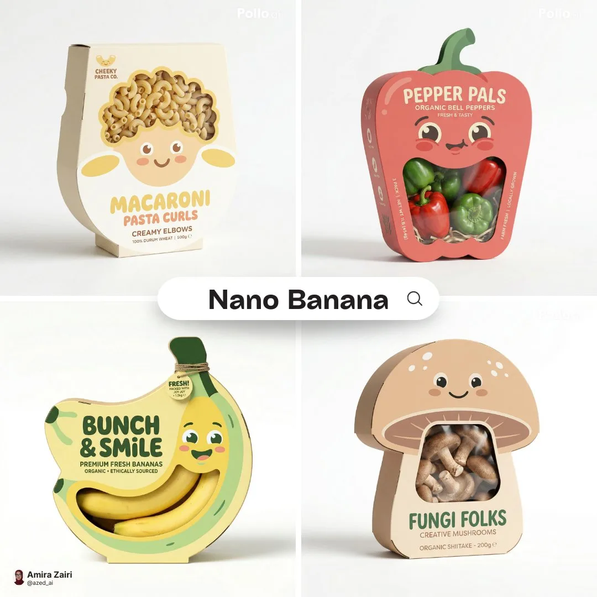

# Amira Zairi — by @azed_ai

[← Back to Examples from X](../../EXAMPLES.md) · Category: Product & Brand · Model: `Nano Banana`

<a href="https://x.com/azed_ai/status/2027806040109289487"></a>

Original post: **[@azed_ai on X](https://x.com/azed_ai/status/2027806040109289487)** · Creator: [Amira Zairi](https://x.com/azed_ai)

## Prompt

```text
Playful designer packaging for [product name], creative box shaped like the product, integrated cartoon face on the front panel, oversized die-cut window revealing the real contents as part of the character’s expression, smooth matte cardboard material, bold flat graphic design, modern minimalist branding, limited pastel color palette, rounded friendly shapes, clean typography, high-end 3D packaging mockup render, soft studio lighting, pure white background, subtle realistic contact shadow beneath, ultra-detailed, retail-ready presentation, 1:1 aspect ratio.
```

## Try it

Paste the prompt into **[vinano.ai](https://vinano.ai?utm_source=github&utm_medium=readme&utm_campaign=awesome-image-video-prompts-updating&utm_content=x-page-try)** to generate your own version.

> The image and prompt belong to [@azed_ai](https://x.com/azed_ai) and are shown here with credit for reference. Creators can ask for changes or removal by opening an issue.
