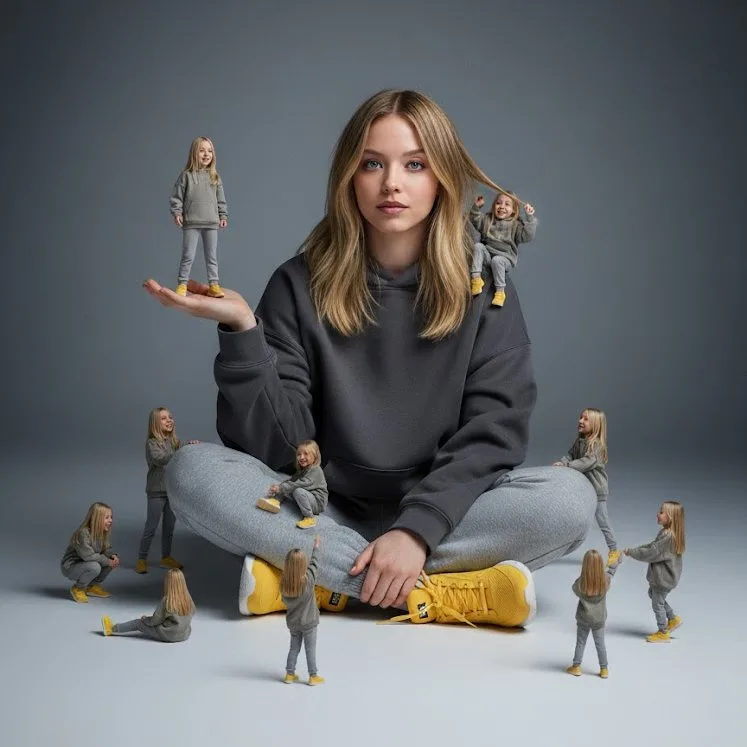

# Cherry 2.O — by @hey_m_cherry

[← Back to Examples from X](../../EXAMPLES.md) · Category: Photography · Model: `Nano Banana`

<a href="https://x.com/hey_m_cherry/status/2011115271239713243"></a>

Original post: **[@hey_m_cherry on X](https://x.com/hey_m_cherry/status/2011115271239713243)** · Creator: [Cherry 2.O](https://x.com/hey_m_cherry)

## Prompt

```text
A creative surreal image of a woman sitting on the ground, wearing a dark yellow hoodie, gray pants, and yellow shoes, surrounded by several miniature versions of himself.

Multiple smaller versions stand on his hands, shoulders, and around him on the ground, interacting playfully with the larger version.

The background is a clean, simple light gray to dark gray tone.

The lighting is soft and cinematic, with realistic shadows and depth of field.
```

## Try it

Paste the prompt into **[vinano.ai](https://vinano.ai?utm_source=github&utm_medium=readme&utm_campaign=awesome-image-video-prompts-updating&utm_content=x-page-try)** to generate your own version.

> The image and prompt belong to [@hey_m_cherry](https://x.com/hey_m_cherry) and are shown here with credit for reference. Creators can ask for changes or removal by opening an issue.
