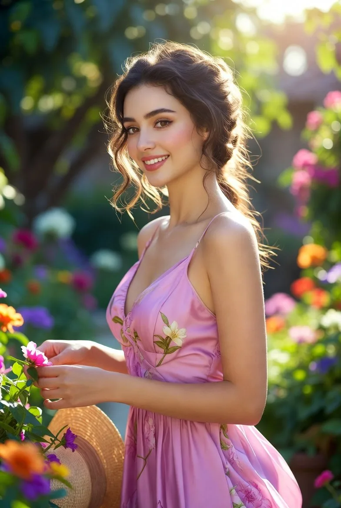

# Aarvi sharma — by @me_Aarvi

[← Back to Community Examples](../../EXAMPLES.md) · Category: Photography · Model: `Nano Banana`

<a href="https://x.com/me_Aarvi/status/2011598044152938767"></a>

Source: **[@me_Aarvi on X](https://x.com/me_Aarvi/status/2011598044152938767)** · Creator: [Aarvi sharma](https://x.com/me_Aarvi)

## Prompt

```text
{
  "prompt": "Use the uploaded reference image STRICTLY to preserve the same woman’s face, identity, facial structure, proportions, and natural expression with 100% accuracy. No facial alteration, beautification, or identity change.\n\nCreate an ultra-realistic black-and-white soft editorial fashion portrait of an elegant woman in a minimalist setting. The composition feels intimate, calm, and timeless, inspired by classic Vogue and Harper’s Bazaar monochrome editorials.\n\nPose & Expression:\nShe stands or leans gently against a neutral textured wall, body slightly angled. Posture is relaxed yet poised. Her expression is serene, introspective, and confident — soft eyes, relaxed lips, no exaggerated emotion. She may gaze slightly away from the camera or directly into the lens with quiet intensity.\n\nOutfit & Styling:\nShe wears a refined, minimal outfit — a softly tailored white or ivory shirt/blouse with clean lines, paired with elegant neutral trousers or a flowing skirt. Fabric textures remain visible and natural, emphasizing realism. No logos, no loud fashion statements — pure quiet luxury.\n\nHair & Makeup:\nHair is styled naturally — loose soft waves, a low bun, or a simple pulled-back look with realistic texture. Makeup is minimal editorial: natural skin, subtle highlights, light contour, soft lashes, and neutral lips. No glamour, no heavy styling.\n\nLighting & Mood:\nSoft directional lighting creates gentle highlights and smooth shadows across the face and clothing. Contrast is controlled and elegant, preserving fine skin texture and fabric detail. Lighting feels organic, editorial, and emotionally calm.\n\nBlack & White Treatment:\nClassic monochrome grading with rich blacks, soft whites, and smooth mid-tones. Film-inspired tonal range with subtle grain for authenticity. No harsh contrast, no crushed shadows.\n\nVisual Style:\nHigh-end fashion editorial photography, timeless black-and-white aesthetic, understated luxury, emotional softness, and artistic restraint.\n\nCamera & Quality:\nProfessional editorial photography, shallow depth of field, cinematic framing, ultra-realistic 8K resolution, sharp subject focus with soft background separation.\n\nOverall Feel:\nQuiet confidence, feminine strength, timeless elegance — a refined black-and-white editorial portrait.",
  
  "style": "black-and-white soft editorial, cinematic realism",
  "lighting": "soft directional light, gentle shadows",
  "color_grade": "classic monochrome, film-inspired tones",
  "background": "minimal neutral textured wall",
  "quality": "ultra-realistic, 8K, editorial detail",
  "camera": "professional fashion photography, shallow depth of field",
  "mood": "calm, timeless, elegant, introspective"
}
```

## Try it

Paste the prompt into **[vinano.ai](https://vinano.ai?utm_source=github&utm_medium=readme&utm_campaign=awesome-image-video-prompts-updating&utm_content=x-page-try)** to generate your own version.

> The image and prompt belong to @me_Aarvi ([original post](https://x.com/me_Aarvi/status/2011598044152938767)) and are shown here with credit for reference. Creators can ask for changes or removal by opening an issue.
