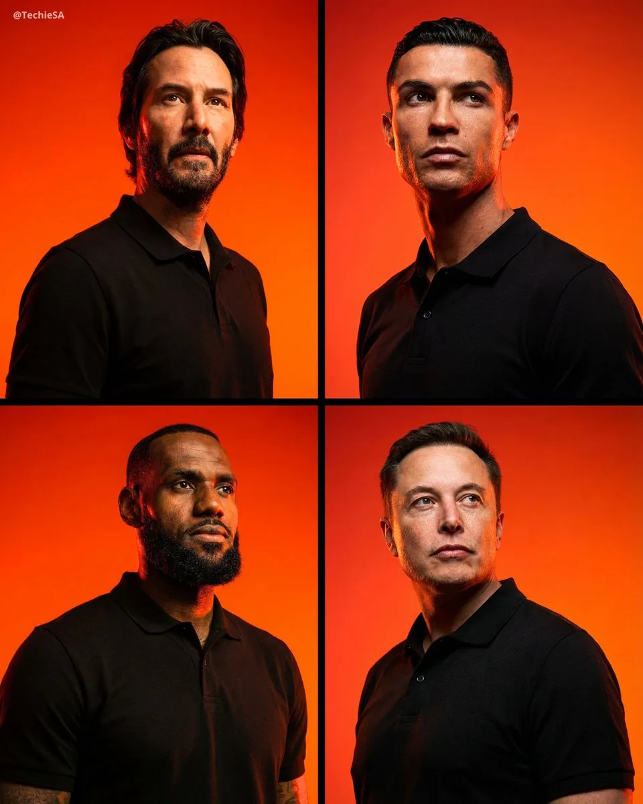

# TechieSA — by @TechieBySA

[← Back to Community Examples](../../EXAMPLES.md) · Category: Photography · Model: `Nano Banana`

<a href="https://x.com/TechieBySA/status/2041841779025019132"></a>

Source: **[@TechieBySA on X](https://x.com/TechieBySA/status/2041841779025019132)** · Creator: [TechieSA](https://x.com/TechieBySA)

## Prompt

```text
ROLE & AESTHETIC:
You are a world-class editorial portrait photographer specializing in dramatic, colorful studio lighting. Your task is to create a powerful, dynamic portrait with a “heroic” feel.
IDENTITY ANCHOR (CRITICAL STRICT CONSTRAINT):
Source: Use the person from the ATTACHED REFERENCE PHOTO.
Preservation: You must keep their exact facial features, skin tone, hairstyle, and natural likeness perfectly unchanged.
Universal Application: Apply the lighting and angle to the subject regardless of gender.
WARDROBE & STYLING:
Attire: A premium Black Pique Polo Shirt
Texture: Visible cotton pique mesh texture
Fit: Fitted and sharp
Color: Deep matte black (to contrast with the bright background)
Expression: Serious, intense, focused. The subject is looking off-camera into the space above, not directly at the lens.
SCENE & COMPOSITION:
Background: A vibrant, solid orange-red backdrop. It should feature smooth, intense color gradients without any patterns, creating a “hot” atmosphere.
Camera Angle (CRITICAL): Low-angle shot (looking up at the subject). This perspective should make the subject look powerful and dominant.
Framing: Medium close-up (focus on face and shoulders).
LIGHTING (DRAMATIC & COLORFUL):
Palette: Dominated by vibrant orange and deep red hues.
Key Light: Strong, directional lighting that casts deep, dramatic shadows on the face (chiaroscuro effect), emphasizing facial structure.
Rim Light: A strong, dramatic edge light (or color cast) that separates the subject’s shoulders and head from the intensely lit background.
Mood: Mysterious, intense, high-contrast studio aesthetic.
TECHNICAL QUALITY:
Style: Photorealistic, highly detailed.
Texture: Sharp focus on the face, contrasting with the smooth gradients of the background.
Skin: Retain natural pores and texture.
```

## Try it

Paste the prompt into **[vinano.ai](https://vinano.ai?utm_source=github&utm_medium=readme&utm_campaign=awesome-image-video-prompts-updating&utm_content=x-page-try)** to generate your own version.

> The image and prompt belong to @TechieBySA ([original post](https://x.com/TechieBySA/status/2041841779025019132)) and are shown here with credit for reference. Creators can ask for changes or removal by opening an issue.
