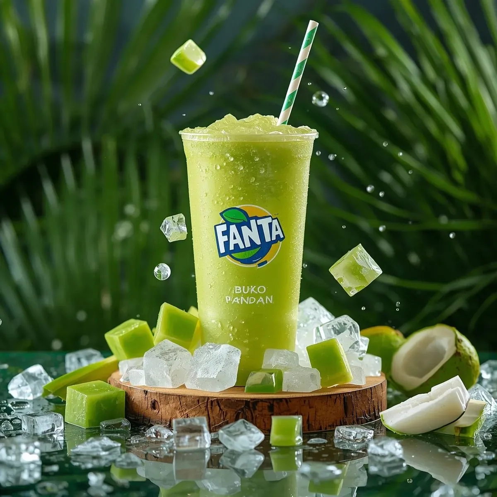

# Kashberg — by @Kashberg_0

[← Back to Examples from X](../../EXAMPLES.md) · Category: Food & Drink · Model: `Nano Banana`

<a href="https://x.com/Kashberg_0/status/2033341324305608968"></a>

Original post: **[@Kashberg_0 on X](https://x.com/Kashberg_0/status/2033341324305608968)** · Creator: [Kashberg](https://x.com/Kashberg_0)

## Prompt

```text
Ultra-realistic commercial product photography of a cold green tropical drink in a transparent plastic cup with Fanta Buko Pandan branding, crushed ice inside, condensation droplets on the cup, green striped paper straw, surrounded by floating ice cubes and pandan jelly cubes, coconut pieces and pandan leaves around the base, drink placed on a small wooden platform, reflective wet surface with scattered ice, tropical jungle leaves background, vibrant green color palette, refreshing summer beverage advertisement, dramatic studio lighting, shallow depth of field, macro details, high-speed splash photography, 8k ultra detailed, professional advertising shot.
Optional parameters
•Aspect ratio: --ar 1:1
•Style: --style raw
•Quality: --q 2

Prompt:

Premium advertising photo of Fanta Buko Pandan tropical beverage, tall clear cup filled with icy green pandan coconut drink, condensation droplets on the cup, white straw, surrounded by crystal ice cubes and pandan jelly cubes, fresh coconut halves and pandan stalks on table, placed on a wooden display stand, glossy reflective surface, lush tropical leaf background with soft bokeh, vibrant green tones, cinematic lighting, hyper-realistic food photography, commercial beverage campaign style, ultra sharp details, 8k resolution, shallow depth of field.
Optional parameters
•Aspect ratio: --ar 1:1
•Lighting: studio softbox lighting
•Style keywords: photorealistic, beverage advertising, macro texture
```

## Try it

Paste the prompt into **[vinano.ai](https://vinano.ai?utm_source=github&utm_medium=readme&utm_campaign=awesome-image-video-prompts-updating&utm_content=x-page-try)** to generate your own version.

> The image and prompt belong to [@Kashberg_0](https://x.com/Kashberg_0) and are shown here with credit for reference. Creators can ask for changes or removal by opening an issue.
