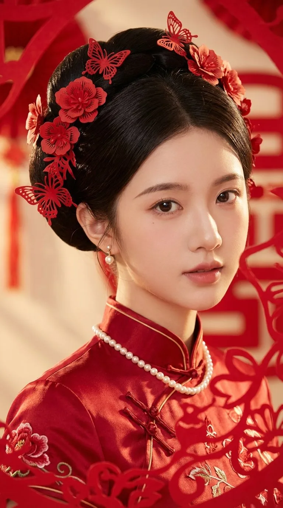

# ttmouse - 豆爸 — by @ttmouse

[← Back to Community Examples](../../EXAMPLES.md) · Category: Photography · Model: `Nano Banana`

<a href="https://x.com/ttmouse/status/2010130164169007195"></a>

Source: **[@ttmouse on X](https://x.com/ttmouse/status/2010130164169007195)** · Creator: [ttmouse - 豆爸](https://x.com/ttmouse)

## Prompt

```text
1. 宏观风格与媒介
- 核心媒介: Photography
- 美学流派: Traditional Chinese bridal portrait

2. 主体与IP身份
- 核心主体: Woman with updo hairstyle adorned with red paper-cut flowers and butterflies, wearing red traditional attire and pearl jewelry
- IP/名人锁定: None

3. 世界逻辑与物理
- 物理法则: Realistic human proportion
- 空间构成: Eye-level perspective, close-up portrait with paper-cut decorative foreground

4. 数据与信息层
- 文本提取: None
- 品牌与符号: None

5. 材质与纹理
- 核心材质: Red satin cheongsam, red paper-cut ornaments, white glossy pearls, small white pearl earring
- 触感细节: Smooth satin texture, delicate paper-cut texture, glossy pearl surface

6. 光影与氛围
- 光照模型: Soft side lighting, soft shadows
- 整体氛围: Warm, elegant, traditional Chinese festive atmosphere

7. 技术参数
- 镜头与渲染: 50mm lens
- 构图指令: --ar 4:5
```

## Try it

Paste the prompt into **[vinano.ai](https://vinano.ai?utm_source=github&utm_medium=readme&utm_campaign=awesome-image-video-prompts-updating&utm_content=x-page-try)** to generate your own version.

> The image and prompt belong to @ttmouse ([original post](https://x.com/ttmouse/status/2010130164169007195)) and are shown here with credit for reference. Creators can ask for changes or removal by opening an issue.
