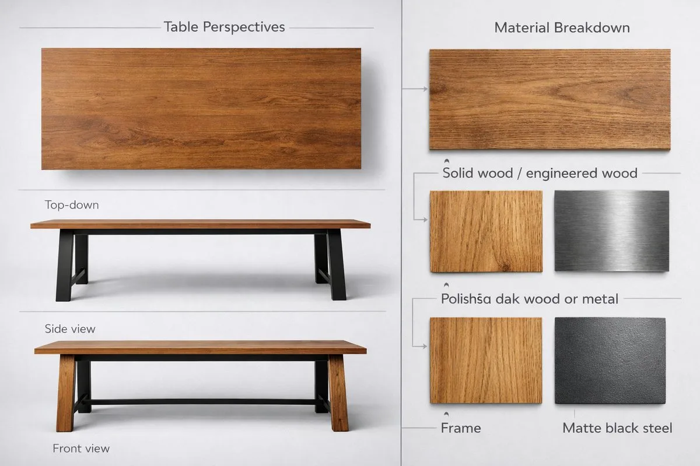

# 𝐌 — by @Strength04_X

[← Back to Examples from X](../../EXAMPLES.md) · Category: Product & Brand · Model: `Nano Banana`

<a href="https://x.com/Strength04_X/status/2018964408417018277"></a>

Original post: **[@Strength04_X on X](https://x.com/Strength04_X/status/2018964408417018277)** · Creator: [𝐌](https://x.com/Strength04_X)

## Prompt

```text
{
  "objective": "Create a detailed product showcase image of a table design with multiple perspectives and material information",
  "image_specifications": {
    "style": "Realistic 3D render or high-quality product illustration",
    "layout": "Split view",
    "aspect_ratio": "3:2 or 4:3",
    "background": "Neutral (light gray or white) to enhance clarity and contrast"
  },
  "left_side": {
    "section_title": "Table Perspectives",
    "views": [
      {
        "view": "Top-down",
        "description": "Display the full table from above, showing tabletop shape, surface texture, and edge details"
      },
      {
        "view": "Side view",
        "description": "Profile of the table to show leg design, table height, and tabletop thickness"
      },
      {
        "view": "Front view",
        "description": "Straight-on view to show width, symmetry, and leg alignment"
      }
    ],
    "visual_style": "Consistent lighting and shadows for realism, subtle shadows to define form"
  },
  "right_side": {
    "section_title": "Material Breakdown",
    "content": [
      {
        "material": "Tabletop Surface",
        "material_type": "Solid wood / engineered wood",
        "swatch_image": "Close-up wood texture sample",
        "label_style": "Clean sans-serif text with arrows pointing to table sections"
      },
      {
        "material": "Legs",
        "material_type": "Polished oak wood or metal",
        "swatch_image": "Close-up material texture sample",
        "label_style": "Consistent labeling with visual connection to perspective images"
      },
      {
        "material": "Frame",
        "material_type": "Matte black steel",
        "swatch_image": "Small metallic texture sample",
        "label_style": "Minimalist annotations"
      }
    ]
  },
  "visual_elements": {
    "separation": "Vertical dividing line or subtle split background",
    "color_palette": "Natural tones for materials, grayscale for background and lines",
    "typography": "Modern, readable font for labels and section titles"
  },
  "output_format": {
    "type": "Image",
    "high_resolution": true,
    "use_case": ["Product sheet", "Interior design catalog", "Furniture showcase"]
  }
}
```

## Try it

Paste the prompt into **[vinano.ai](https://vinano.ai?utm_source=github&utm_medium=readme&utm_campaign=awesome-image-video-prompts-updating&utm_content=x-page-try)** to generate your own version.

> The image and prompt belong to [@Strength04_X](https://x.com/Strength04_X) and are shown here with credit for reference. Creators can ask for changes or removal by opening an issue.
