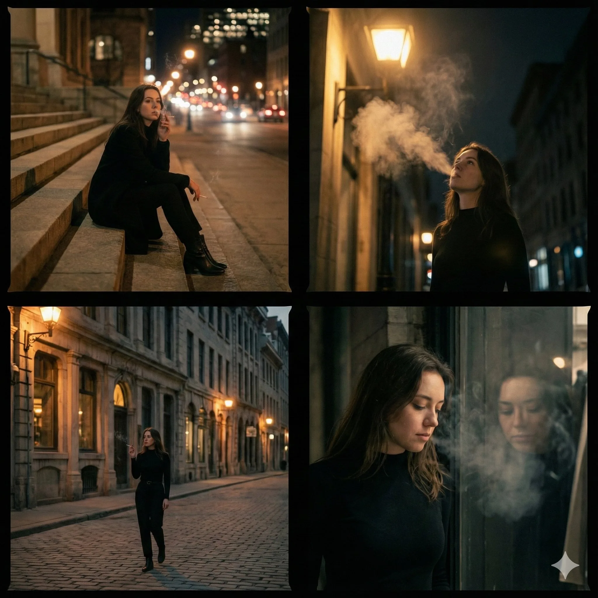

# Smiling Khan — by @AIwithkhan

[← Back to Community Examples](../../EXAMPLES.md) · Category: Photography · Model: `Nano Banana`

<a href="https://x.com/AIwithkhan/status/2008177924651044876"></a>

Source: **[@AIwithkhan on X](https://x.com/AIwithkhan/status/2008177924651044876)** · Creator: [Smiling Khan](https://x.com/AIwithkhan)

## Prompt

```text
A cinematic 4-panel photo collage showing a quiet, introspective city walk with smoking as a character detail.
• Frame 1: Sitting briefly on wide stone stairs, cigarette lit, city lights behind
• Frame 2: Standing still under a warm streetlamp, slow smoke drifting upward
• Frame 3: Walking past old European buildings, cigarette between fingers
• Frame 4: Pausing near a closed shop window, reflection visible with smoke haze
Consistent outfit — minimalist black outfit, ankle boots. Low-key lighting, soft bokeh, cinematic shadows, film-still realism, editorial mood, 1:1 aspect ratio.
```

## Try it

Paste the prompt into **[vinano.ai](https://vinano.ai?utm_source=github&utm_medium=readme&utm_campaign=awesome-image-video-prompts-updating&utm_content=x-page-try)** to generate your own version.

> The image and prompt belong to @AIwithkhan ([original post](https://x.com/AIwithkhan/status/2008177924651044876)) and are shown here with credit for reference. Creators can ask for changes or removal by opening an issue.
