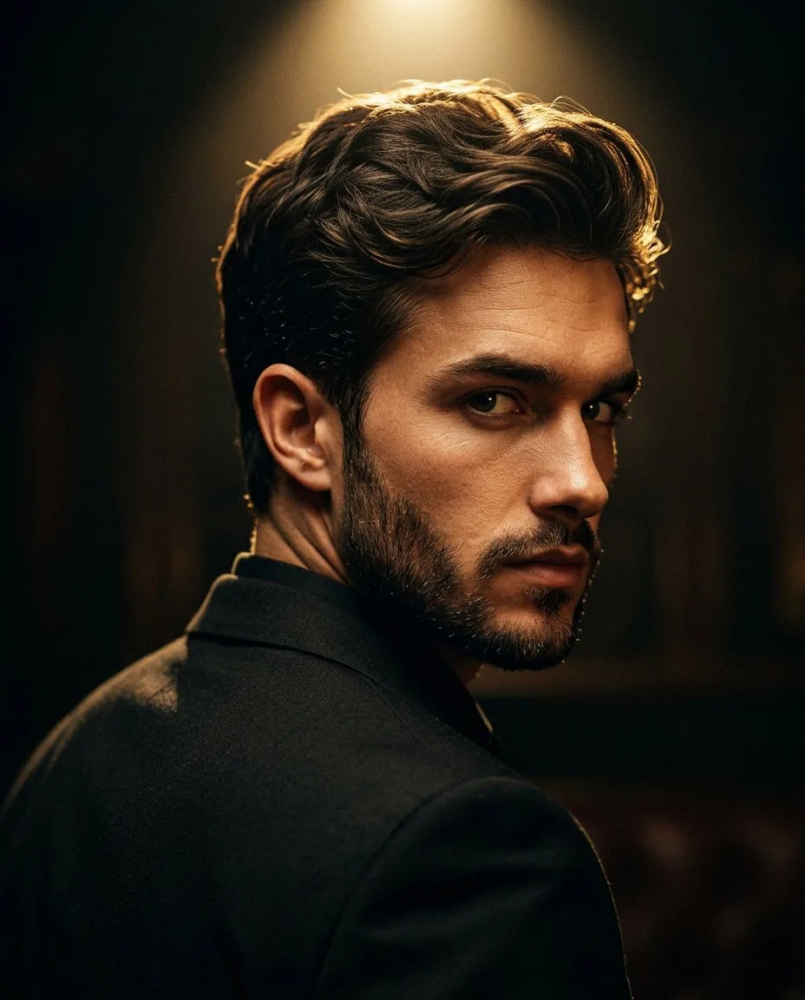

# K — by @ChillaiKalan__

[← Back to Community Examples](../../EXAMPLES.md) · Category: Photography · Model: `Nano Banana`

<a href="https://x.com/ChillaiKalan__/status/2034783762769486109"></a>

Source: **[@ChillaiKalan__ on X](https://x.com/ChillaiKalan__/status/2034783762769486109)** · Creator: [K](https://x.com/ChillaiKalan__)

## Prompt

```text
Ultra-realistic cinematic portrait of a stylish man in a black suit, captured from behind with his head turned over his shoulder, giving a sharp, intense look toward the camera. Short textured hair with subtle highlights, well-groomed beard. Dramatic spotlight from above creating a warm golden halo effect on his hair and face, fading into a dark background. Strong chiaroscuro lighting with deep shadows and soft highlights.
```

## Try it

Paste the prompt into **[vinano.ai](https://vinano.ai?utm_source=github&utm_medium=readme&utm_campaign=awesome-image-video-prompts-updating&utm_content=x-page-try)** to generate your own version.

> The image and prompt belong to @ChillaiKalan__ ([original post](https://x.com/ChillaiKalan__/status/2034783762769486109)) and are shown here with credit for reference. Creators can ask for changes or removal by opening an issue.
