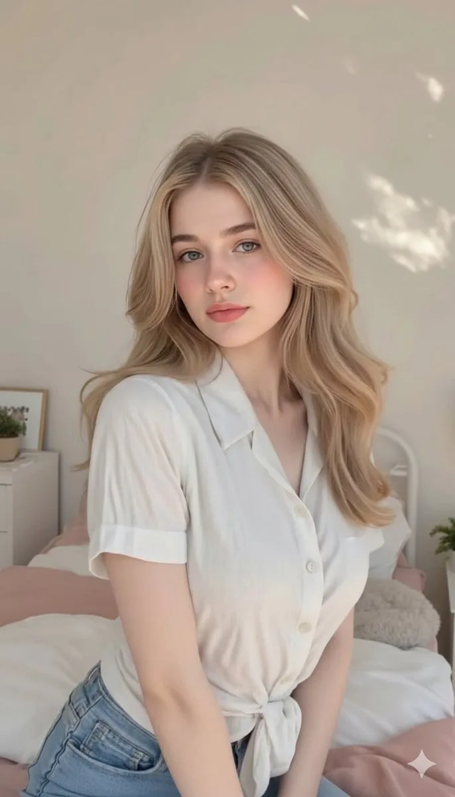

# Aylin — by @Ai_aylinfc

[← Back to Community Examples](../../EXAMPLES.md) · Category: Photography · Model: `Nano Banana`

<a href="https://x.com/Ai_aylinfc/status/2017166130746675620"></a>

Source: **[@Ai_aylinfc on X](https://x.com/Ai_aylinfc/status/2017166130746675620)** · Creator: [Aylin](https://x.com/Ai_aylinfc)

## Prompt

```text
Cute, innocent young adult blonde woman  sitting comfortably on a neatly made bed, relaxed natural posture with legs gently bent, shoulders soft and at ease. Long, soft, flowing blonde hair styled in loose natural waves, silky texture, subtle shine, a few delicate strands framing her face. Clear blue eyes with a gentle sparkle, long natural lashes, delicate eyebrows, smooth fair complexion with a soft healthy glow, subtle blush on cheeks, light pink lips, minimal natural makeup enhancing her youthful features. Calm, sweet, peaceful expression conveying warmth and innocence.

Wearing a clean white short-sleeve cotton shirt, lightweight fabric, neatly tied at the waist with natural folds and creases, paired with light-wash high-waisted jeans, casual fit, realistic denim texture, visible stitching and seams, effortlessly stylish yet simple.

Bright, cozy bedroom interior filled with soft natural light, white and cream color palette, minimal modern decor, neatly arranged pillows, soft linen bedsheets, light wooden bed frame and furniture, a large window nearby with sheer curtains gently diffusing the sunlight. Warm morning or late-afternoon sunlight streaming in, creating soft highlights on her hair and skin, gentle shadows for depth, peaceful and intimate atmosphere, calm lifestyle mood.

Photorealistic, ultra-high detail, hyper-detailed skin texture with visible natural pores and softness, realistic hair strands with depth and volume, accurate fabric textures, lifelike color tones. Shot on Canon DSLR, 50mm f/1.8 lens, shallow depth of field, creamy natural bokeh background, sharp focus on eyes and face, natural lighting only, no artificial flash. Soft cinematic yet true-to-life color grading, lifestyle editorial photography style, clean balanced composition, vertical framing, realistic perspective, professional photography quality.
--ar 3:4 --stylize 250 --v 6 --q 2
```

## Try it

Paste the prompt into **[vinano.ai](https://vinano.ai?utm_source=github&utm_medium=readme&utm_campaign=awesome-image-video-prompts-updating&utm_content=x-page-try)** to generate your own version.

> The image and prompt belong to @Ai_aylinfc ([original post](https://x.com/Ai_aylinfc/status/2017166130746675620)) and are shown here with credit for reference. Creators can ask for changes or removal by opening an issue.
