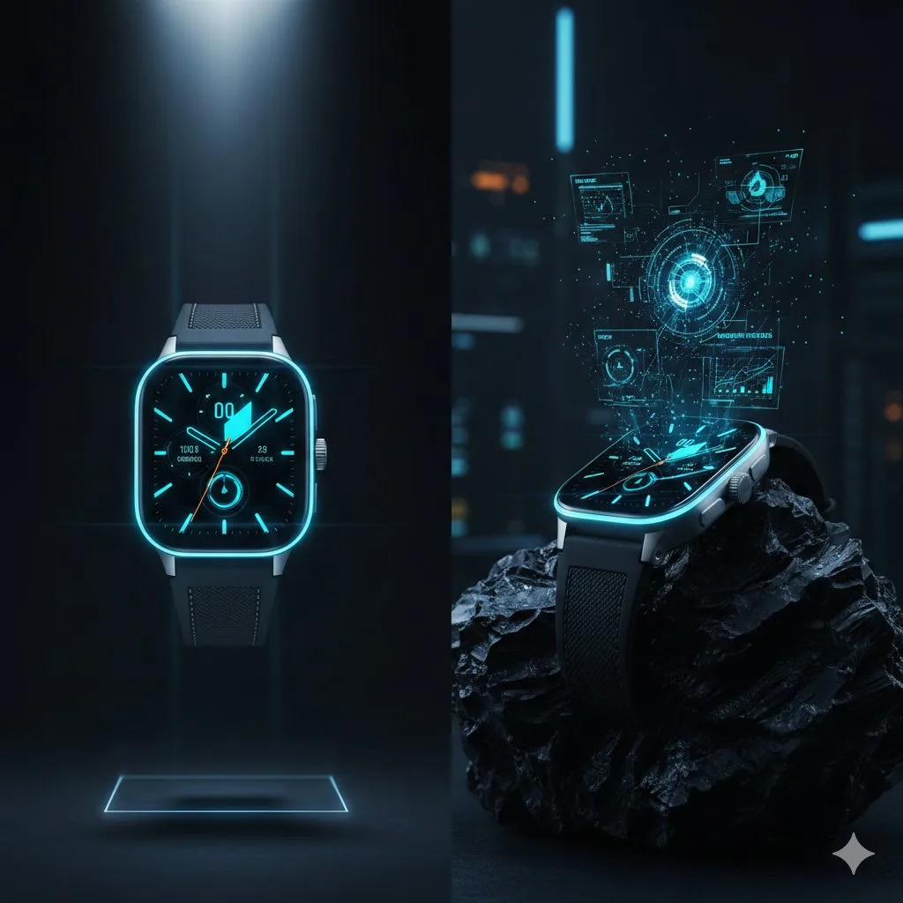

# Meem — by @mehvishs25

[← Back to Examples from X](../../EXAMPLES.md) · Category: Product & Brand · Model: `Nano Banana`

<a href="https://x.com/mehvishs25/status/2017793115147444527"></a>

Original post: **[@mehvishs25 on X](https://x.com/mehvishs25/status/2017793115147444527)** · Creator: [Meem](https://x.com/mehvishs25)

## Prompt

```text
{
  "campaign_metadata": {
    "brand_identity": "Quantum Horizon Tech",
    "product_focus": "Titanium Luxury Smartwatch",
    "aspect_ratio": "3:4",
    "aesthetic": "Cyber-Luxury | Technical Minimalism"
  },
  "visual_dna": {
    "materials": ["Brushed Aerospace Titanium", "Sapphire Crystal", "Fluorocarbon Strap"],
    "color_scheme": ["Space Grey", "Electric Cyan", "Matte Black"],
    "lighting": "Top-down Rim Lighting | Neon Accents | Cold Studio Tones"
  },
  "grid_layout_execution": {
    "row_1_precision": {
      "cell_1_1": "Hero: Watch floating vertically, illuminated by a single beam of light.",
      "cell_1_2": "Macro: The digital crown's knurled texture and the red action button detail.",
      "cell_1_3": "Dynamic: Liquid metal ripples splashing against the titanium casing."
    },
    "row_2_lifestyle": {
      "cell_2_1": "Minimal: Watch resting on a raw piece of jagged obsidian rock.",
      "cell_2_2": "Innovation: Holographic UI elements projecting from the watch face into the air.",
      "cell_2_3": "Sensory: Close-up of the strap clicking into the magnetic lug with precision."
    },
    "row_3_surreal": {
      "cell_3_1": "Color: A gradient of deep blues and purples with light-trail long exposure.",
      "cell_3_2": "Abstraction: Deconstructed internal gears and chips floating like a nebula.",
      "cell_3_3": "Fusion: The watch submerged in a digital 'data' ocean with glowing currents."
    }
  }
}
```

## Try it

Paste the prompt into **[vinano.ai](https://vinano.ai?utm_source=github&utm_medium=readme&utm_campaign=awesome-image-video-prompts-updating&utm_content=x-page-try)** to generate your own version.

> The image and prompt belong to [@mehvishs25](https://x.com/mehvishs25) and are shown here with credit for reference. Creators can ask for changes or removal by opening an issue.
