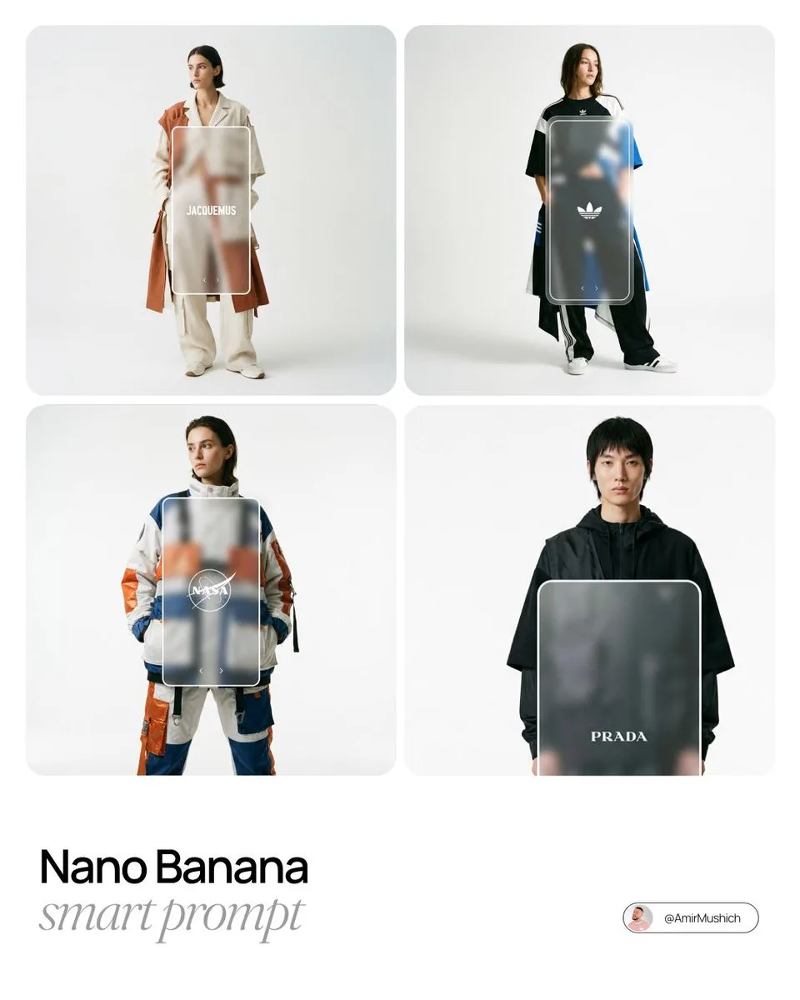

# AmirMušić — by @AmirMushich

[← Back to Community Examples](../../EXAMPLES.md) · Category: Poster Design · Model: `Nano Banana`

<a href="https://x.com/AmirMushich/status/2011509897175724329"></a>

Source: **[@AmirMushich on X](https://x.com/AmirMushich/status/2011509897175724329)** · Creator: [AmirMušić](https://x.com/AmirMushich)

## Prompt

```text
[BRAND NAME]. Act as a Creative Director and Fashion Photographer creating a high-end editorial lookbook image with a UI overlay layer.
1. THE SUBJECT (AVANT-GARDE STREETWEAR & NATURAL POSE):
A fashion model stands centrally in a clean studio.
Fashion Style: The outfit is a striking, conceptual "Modern Avant-Garde Streetwear" look that interprets the aesthetic and color palette of [BRAND NAME]. Think high-fashion meets street culture: experimental silhouettes, deconstructed layering, oversized proportions, unique material combinations, and bold details. It should feel innovative and editorial, but still grounded in streetwear, avoiding basic casual clothes.
Pose: The model adopts a natural, relaxed, and effortless editorial pose (e.g., hands casually in pockets, a slight lean, looking off-camera or gently at the camera). Absolutely NO robotic, stiff, or "T-pose" stances.
2. THE UI OVERLAY (FROSTED GLASS RECTANGLE):
Superimposed directly in front of the model's torso is a large, vertical Floating UI Element.
Shape & Outline: A simple vertical rectangle with rounded corners, framed by a clean 2px solid White Stroke.
Material (Glassmorphism): The interior of this rectangle is "Frosted Glass". The part of the model's outfit behind this glass must be heavily blurred (high Gaussian Blur), creating a translucent depth effect, while the rest of the model remains razor-sharp.
3. UI CONTENT (MINIMALIST & SMALL):
Inside the frosted glass pane, place two elements in pure Monochrome White:
Center: The official [BRAND NAME] logo, perfectly centered.
Below Logo: Positioned significantly higher than the bottom edge, place two VERY SMALL, minimalist white navigation arrows (one pointing Left "<", one pointing Right ">"). They should be subtle and approximately 50% smaller than standard UI icons.
4. PHOTOGRAPHY STYLE & COMPOSITION (STRICT FRAMING):
Style: High-End Editorial Fashion Photography. Real film grain, sophisticated soft studio lighting that emphasizes fabric textures. It must look like a real photograph, not a CGI render.
Background: Infinite, pure White Studio Cyclorama.
Framing (STRICT CONSTRAINT): The shot is a Wide Full-Body Photograph. The entire model (from top of head to bottom of feet) AND the entire UI overlay must be COMPLETELY CONTAINED within the image boundaries. There must be absolutely ZERO CROPPING of the subject or UI. There must be a very large, generous amount of empty negative space ("air") surrounding the subject on all four sides.
```

## Try it

Paste the prompt into **[vinano.ai](https://vinano.ai?utm_source=github&utm_medium=readme&utm_campaign=awesome-image-video-prompts-updating&utm_content=x-page-try)** to generate your own version.

> The image and prompt belong to @AmirMushich ([original post](https://x.com/AmirMushich/status/2011509897175724329)) and are shown here with credit for reference. Creators can ask for changes or removal by opening an issue.
