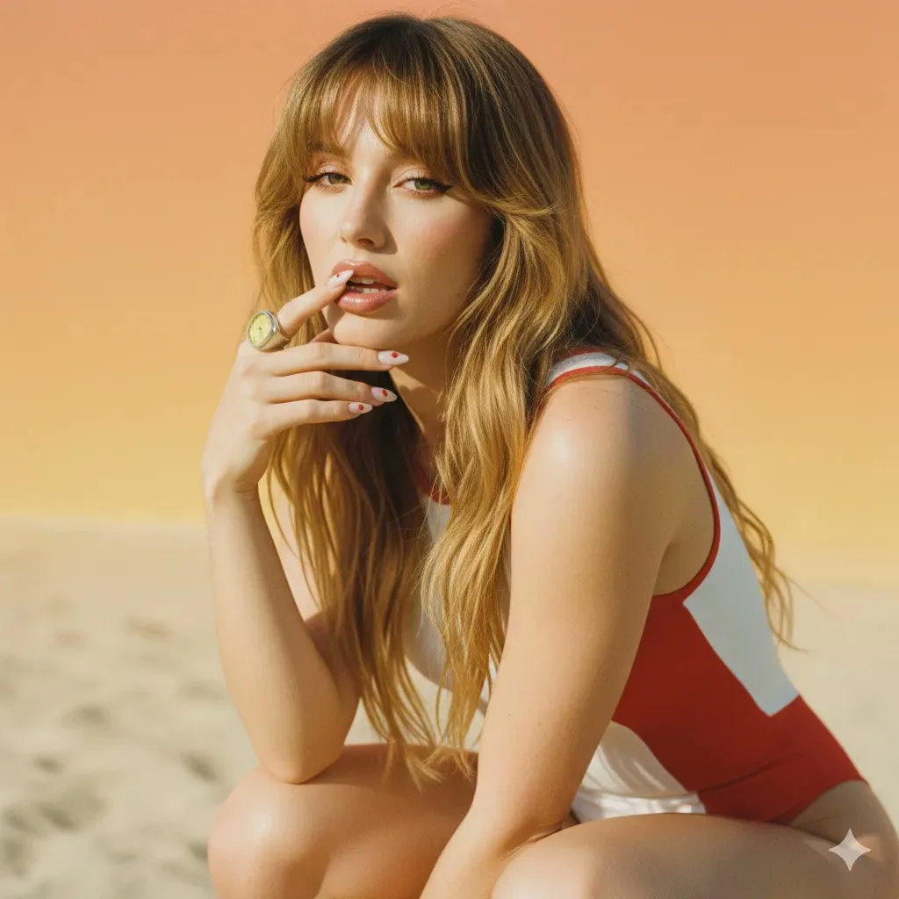

# lilzula — by @lilzula_009_me

[← Back to Community Examples](../../EXAMPLES.md) · Category: Photography · Model: `Nano Banana`

<a href="https://x.com/lilzula_009_me/status/2012364198672547950"></a>

Source: **[@lilzula_009_me on X](https://x.com/lilzula_009_me/status/2012364198672547950)** · Creator: [lilzula](https://x.com/lilzula_009_me)

## Prompt

```text
{
  "image_request": {
    "style": {
      "genre": "Editorial fashion portrait",
      "aesthetic": "2000s retro-pop, Californian summer vibe",
      "mood": "Confident, sultry, youthful",
      "quality": "High-quality, cinematic",
      "aspect_ratio": "Portrait"
    },
    "identity": {
      "face_lock": "Use the original face exactly as provided",
      "constraints": "Do not change any facial features, proportions, asymmetry, or details",
      "realism": "100% photorealistic face preservation"
    },
    "subject": {
      "gender": "Woman",
      "expression": "Confident and sultry",
      "mouth": "Slightly open",
      "gaze": "Direct eye contact with the camera"
    },
    "hair": {
      "color": "Soft golden-brown",
      "length": "Long",
      "style": "Shaggy haircut with full bangs"
    },
    "pose": {
      "body_position": "Crouching forward",
      "hands": {
        "gesture": "One hand raised to the face",
        "detail": "Finger touching bottom lip"
      },
      "attitude": "Bold, self-assured"
    },
    "fashion": {
      "outfit": "White and red athletic-style bodysuit"
    },
    "makeup": {
      "eyes": "Peach eyeshadow with winged eyeliner",
      "lips": "Glossy berry-red lipstick",
      "overall": "Soft, warm-toned editorial makeup"
    },
    "accessories": {
      "jewelry": "Chunky silver jewelry",
      "ring": "Large silver ring with yellow watch-face detail",
      "nails": {
        "style": "Long manicured nails",
        "design": "Red heart accents"
      }
    },
    "lighting": {
      "type": "Bright, warm, high-key natural sunlight",
      "shadows": "Soft and natural"
    },
    "environment": {
      "background": "Blurred warm orange and sandy-yellow gradient",
      "suggested_location": "Outdoor desert or poolside atmosphere"
    },
    "camera": {
      "style": "35mm film photography look",
      "focus": "Sharp focus on face and hand",
      "depth_of_field": "Shallow depth of field",
      "color": "Vibrant, cinematic tones"
    },
    "final_notes": {
      "textures": "Natural skin, hair, and fabric detail",
      "editing": "No face alteration, no over-smoothing",
      "overall_feel": "High-fashion cinematic editorial portrait"
    }
  }
}
```

## Try it

Paste the prompt into **[vinano.ai](https://vinano.ai?utm_source=github&utm_medium=readme&utm_campaign=awesome-image-video-prompts-updating&utm_content=x-page-try)** to generate your own version.

> The image and prompt belong to @lilzula_009_me ([original post](https://x.com/lilzula_009_me/status/2012364198672547950)) and are shown here with credit for reference. Creators can ask for changes or removal by opening an issue.
