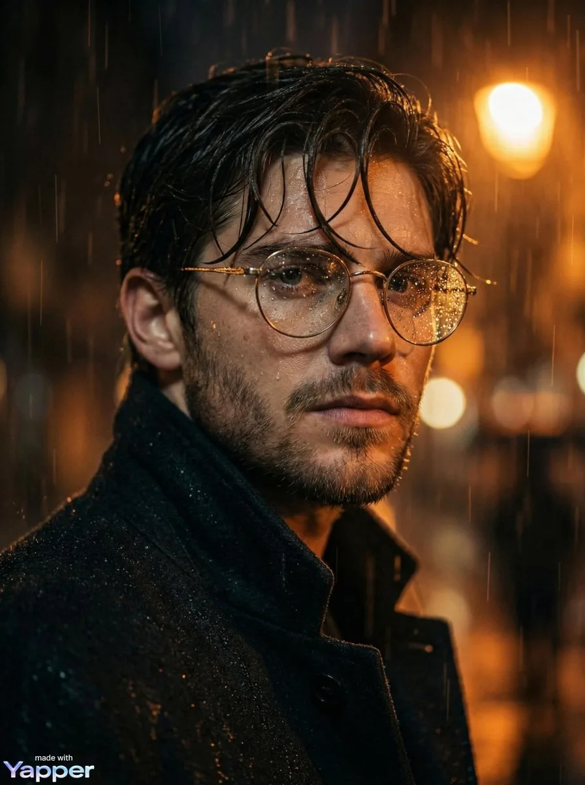

# Aijaz — by @iamsofiaijaz

[← Back to Examples from X](../../EXAMPLES.md) · Category: Photography · Model: `Nano Banana`

<a href="https://x.com/iamsofiaijaz/status/2030797695405936926"></a>

Original post: **[@iamsofiaijaz on X](https://x.com/iamsofiaijaz/status/2030797695405936926)** · Creator: [Aijaz](https://x.com/iamsofiaijaz)

## Prompt

```text
Cinematic close-up portrait of a young man standing in heavy rain at night, wearing round metal glasses and a dark coat, wet hair falling across his forehead, light stubble beard. Raindrops clinging to his glasses and skin, dramatic moody lighting with warm orange streetlight bokeh in the background, shallow depth of field, intense contemplative expression, gritty noir atmosphere, ultra-realistic, high contrast, detailed skin texture, cinematic color grading, 85mm lens, f/1.8,photorealistic, dark urban aesthetic, film still look.
```

## Try it

Paste the prompt into **[vinano.ai](https://vinano.ai?utm_source=github&utm_medium=readme&utm_campaign=awesome-image-video-prompts-updating&utm_content=x-page-try)** to generate your own version.

> The image and prompt belong to [@iamsofiaijaz](https://x.com/iamsofiaijaz) and are shown here with credit for reference. Creators can ask for changes or removal by opening an issue.
