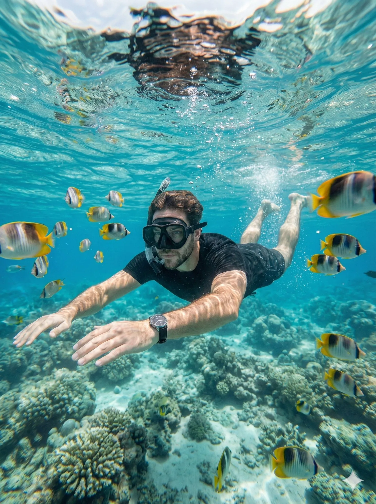

# 𝐌 — by @Strength04_X

[← Back to Community Examples](../../EXAMPLES.md) · Category: Photography · Model: `Nano Banana`

<a href="https://x.com/Strength04_X/status/2010666164129849800"></a>

Source: **[@Strength04_X on X](https://x.com/Strength04_X/status/2010666164129849800)** · Creator: [𝐌](https://x.com/Strength04_X)

## Prompt

```text
Create a hyper-realistic underwater close-range portrait captured with a wide-angle action camera in a waterproof housing. The camera is very close to the Subject (≈0.5–1 m), positioned slightly below face level and angled upward, with wide-angle distortion emphasizing depth while keeping the Subject dominant.

Mid-shot to ¾ body framing. The Subject fills most of the frame, with face and upper body clearly visible. Schools of tropical fish swim closely around, some passing near the lens to create layered depth, with mild motion blur on fish closest to the camera.

Natural sunlight enters from above, producing bright caustic patterns on the Subject and surrounding water, strong highlights near the surface, and soft blue gradients below. Floating water particles are visible between the camera and Subject, with slight refraction distortion around mask edges and hands.

The Subject appears calm and relaxed, floating effortlessly with subtle body movement suggesting buoyancy and breathing through the snorkel.

A shallow coral reef is visible below, slightly softened by depth, while nearby fish remain sharper. The water surface shimmers above with gentle ripples.

Color behavior reflects natural underwater absorption: dominant blues and aquas, vibrant yellow and black fish patterns retained, and skin tones realistic with a slightly cool cast.

The image should feel like a real close-distance snorkeling travel photo intimate, immersive, and authentic.

Do not alter facial structure or identity. The Subject must remain 1000% identical to the reference image.
```

## Try it

Paste the prompt into **[vinano.ai](https://vinano.ai?utm_source=github&utm_medium=readme&utm_campaign=awesome-image-video-prompts-updating&utm_content=x-page-try)** to generate your own version.

> The image and prompt belong to @Strength04_X ([original post](https://x.com/Strength04_X/status/2010666164129849800)) and are shown here with credit for reference. Creators can ask for changes or removal by opening an issue.
