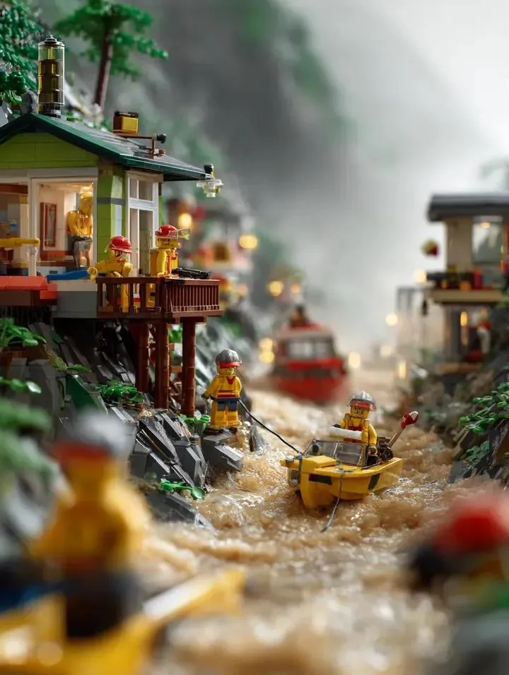

# 𝐌 — by @Strength04_X

[← Back to Community Examples](../../EXAMPLES.md) · Category: Illustration & 3D · Model: `Nano Banana`

<a href="https://x.com/Strength04_X/status/2015486383713116644"></a>

Source: **[@Strength04_X on X](https://x.com/Strength04_X/status/2015486383713116644)** · Creator: [𝐌](https://x.com/Strength04_X)

## Prompt

```text
LEGO mountain flood rescue scene, torrential rain causing river overflow in a LEGO mountain village, rescue boats and ropes used by LEGO firefighters, houses perched on slopes surrounded by muddy floodwater, misty mountains in background, dramatic cinematic lighting, intense LEGO disaster realism --ar 3:4
```

## Try it

Paste the prompt into **[vinano.ai](https://vinano.ai?utm_source=github&utm_medium=readme&utm_campaign=awesome-image-video-prompts-updating&utm_content=x-page-try)** to generate your own version.

> The image and prompt belong to @Strength04_X ([original post](https://x.com/Strength04_X/status/2015486383713116644)) and are shown here with credit for reference. Creators can ask for changes or removal by opening an issue.
