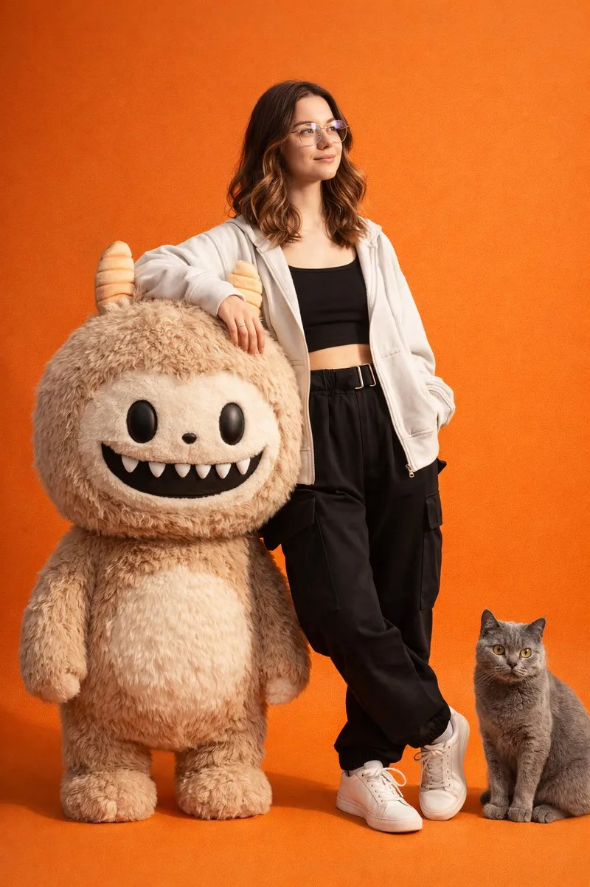

# simeon-sanai — by @Naiknelofar788

[← Back to Examples from X](../../EXAMPLES.md) · Category: Photography · Model: `Nano Banana`

<a href="https://x.com/Naiknelofar788/status/2021574480766943706"></a>

Original post: **[@Naiknelofar788 on X](https://x.com/Naiknelofar788/status/2021574480766943706)** · Creator: [simeon-sanai](https://x.com/Naiknelofar788)

## Prompt

```text
Create a hyper-realistic, high-detail studio photoshoot featuring the same person from the reference photo with the exact facial features, skin tone, hairstyle, proportions, and identity fully preserved (no changes to face or structure). She is wearing stylish Gen-Z fashion attire trendy, minimal, modern streetwear. She is leaning casually on a realistic, fluffy, life-sized Labubu character, rendered in soft fur texture with playful expression. A British Shorthair cat sits or poses nearby, also hyperrealistic with detailed fur and natural posture.

The entire scene is set against a smooth, seamless, vibrant orange studio backdrop with professional studio lighting, crisp shadows, clean highlights, and a premium fashion editorial vibe. Ultra-photorealistic, flawless skin texture (but unchanged identity), high-end photography style, full-body or mid-shot composition.
```

## Try it

Paste the prompt into **[vinano.ai](https://vinano.ai?utm_source=github&utm_medium=readme&utm_campaign=awesome-image-video-prompts-updating&utm_content=x-page-try)** to generate your own version.

> The image and prompt belong to [@Naiknelofar788](https://x.com/Naiknelofar788) and are shown here with credit for reference. Creators can ask for changes or removal by opening an issue.
