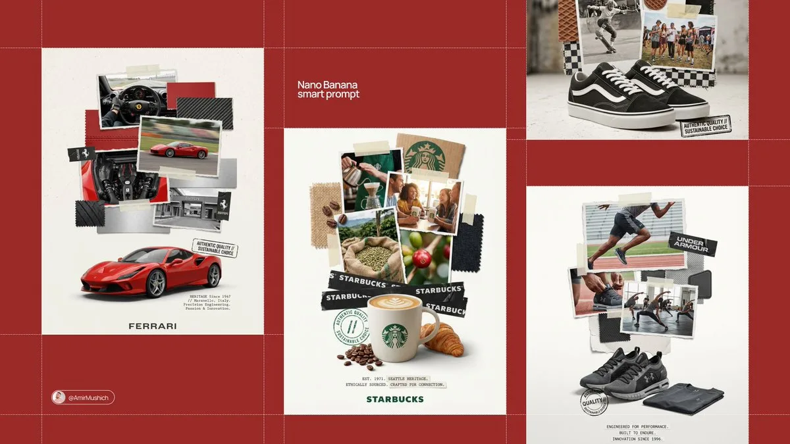

# AmirMušić — by @AmirMushich

[← Back to Community Examples](../../EXAMPLES.md) · Category: Poster Design · Model: `Nano Banana`

<a href="https://x.com/AmirMushich/status/2031446250214572438"></a>

Source: **[@AmirMushich on X](https://x.com/AmirMushich/status/2031446250214572438)** · Creator: [AmirMušić](https://x.com/AmirMushich)

## Prompt

```text
[BRAND NAME]

[PRODUCT TYPE] (Clothing / Food / Automotive / Tech).

Goal: Generate a professional "scrapbook" style collage poster for [BRAND NAME] centered around a [PRODUCT TYPE].

1. HERO PRODUCT (BOTTOM FOCUS)

- Object: A high-definition, realistic 3D render of a [PRODUCT TYPE] by [BRAND NAME] at the bottom center.

- Placement: Slightly angled to show depth, with soft realistic contact shadows on a plain off-white floor.

2. THE MULTI-LAYERED COLLAGE STACK

- Photos: A vertical stack of overlapping photos with RAGGED, TORN paper edges rising above the product.

- Content: Photos should show [PRODUCT TYPE] in use, lifestyle shots related to [BRAND NAME], and close-ups of specific details.

- Materials: Physical swatches of textures related to [PRODUCT TYPE] (e.g., leather/fabric for clothing, metal/carbon for cars, organic ingredients for food). Include visible raw edges and stitching.

- Fasteners: Use strips of semi-transparent masking tape and black duct tape with the "[BRAND NAME]" logo printed in white to "hold" the pieces together.

3. GRAPHIC OVERLAYS & STAMPS

- Stamp: A black, distressed ink stamp or seal near the hero product with text: "AUTHENTIC QUALITY // SUSTAINABLE CHOICE".

- Typography: Small, clean sans-serif and typewriter-style text blocks describing the heritage of [BRAND NAME] placed at the bottom.

- Logo: The primary "[BRAND NAME]" logo centered at the very bottom in a minimalist font.

4. STYLE & ATMOSPHERE

- Aesthetic: Industrial DIY, workshop moodboard, high-end editorial collage.

- Lighting: Bright, studio high-key lighting with soft, multi-layered shadows between the paper scraps and textures.

- Quality: 8K resolution, macro detail on paper grain, fabric fibers, and tape adhesive.
```

## Try it

Paste the prompt into **[vinano.ai](https://vinano.ai?utm_source=github&utm_medium=readme&utm_campaign=awesome-image-video-prompts-updating&utm_content=x-page-try)** to generate your own version.

> The image and prompt belong to @AmirMushich ([original post](https://x.com/AmirMushich/status/2031446250214572438)) and are shown here with credit for reference. Creators can ask for changes or removal by opening an issue.
