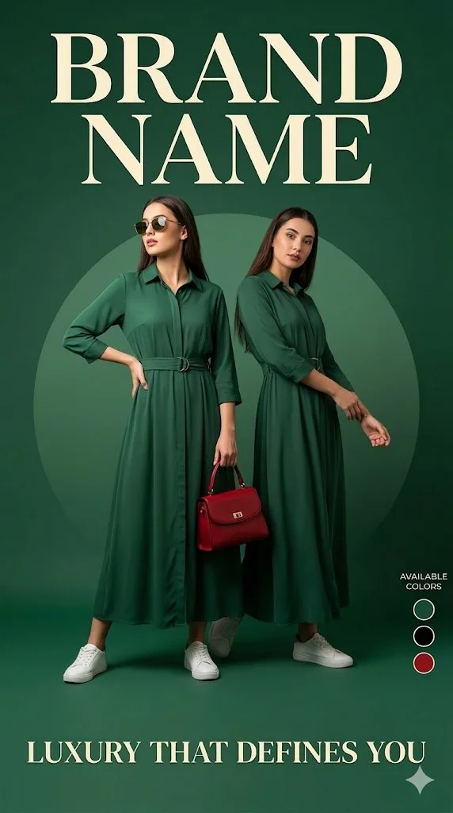

# auqib — by @auqibhabib

[← Back to Community Examples](../../EXAMPLES.md) · Category: Product & Brand · Model: `Nano Banana`

<a href="https://x.com/auqibhabib/status/2030906462999122123"></a>

Source: **[@auqibhabib on X](https://x.com/auqibhabib/status/2030906462999122123)** · Creator: [auqib](https://x.com/auqibhabib)

## Prompt

```text
Luxury fashion advertisement poster, deep green background with a soft circular gradient behind the model, two stylish female models standing full body. First model wearing a long elegant green dress with waist belt, white sneakers, sunglasses, holding a red handbag, confident pose with one hand on waist looking sideways. Second female model standing beside her in a different pose, slightly angled stance with relaxed arms, wearing a similar elegant fashion outfit matching the luxury theme. Studio lighting, minimal shadows, ultra-clean composition, premium fashion campaign style.

At the top place large bold luxury serif text “BRAND NAME” (same placement and style as luxury fashion brands).

At the bottom add text:
“LUXURY THAT DEFINES YOU”
Below it smaller text:

Add a small side section titled “AVAILABLE COLORS” with three small circular color indicators: Green, Black, Red.

Highly detailed, fashion catalog quality, DSLR photography style, 8k resolution, symmetrical layout, luxury branding aesthetic, professional advertising poster.
```

## Try it

Paste the prompt into **[vinano.ai](https://vinano.ai?utm_source=github&utm_medium=readme&utm_campaign=awesome-image-video-prompts-updating&utm_content=x-page-try)** to generate your own version.

> The image and prompt belong to @auqibhabib ([original post](https://x.com/auqibhabib/status/2030906462999122123)) and are shown here with credit for reference. Creators can ask for changes or removal by opening an issue.
