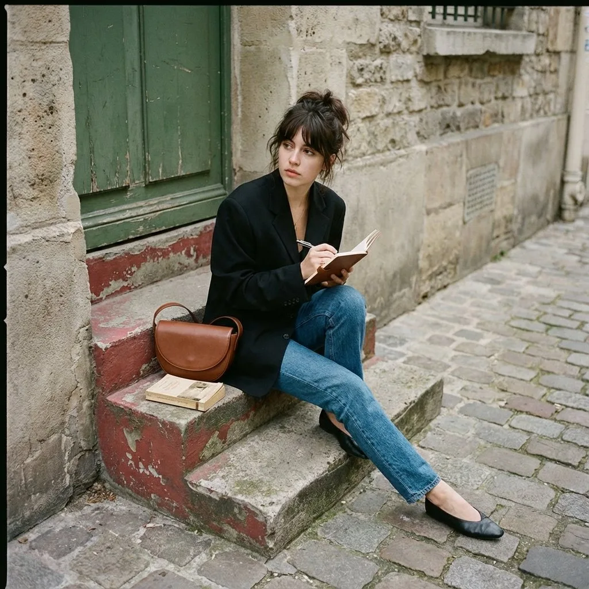

# 𝗦𝗮𝗻𝗶𝗮 — by @saniaspeaks_

[← Back to Community Examples](../../EXAMPLES.md) · Category: Photography · Model: `Nano Banana`

<a href="https://x.com/saniaspeaks_/status/2015795776363081772"></a>

Source: **[@saniaspeaks_ on X](https://x.com/saniaspeaks_/status/2015795776363081772)** · Creator: [𝗦𝗮𝗻𝗶𝗮](https://x.com/saniaspeaks_)

## Prompt

```text
{
  "image_generation": {
    "subject": {
      "description": "young woman sitting on stone steps in a quiet old European street",
      "pose": "seated casually on worn stone stairs, legs crossed slightly, holding a notebook and pen",
      "expression": "thoughtful, calm, introspective",
      "action": "writing notes while glancing to the side"
    },
    "appearance": {
      "hair": {
        "color": "dark brown",
        "style": "messy bun with soft bangs framing the face"
      },
      "face": {
        "features": "soft natural facial features",
        "makeup": "minimal, natural look"
      }
    },
    "outfit": {
      "top": "black oversized blazer",
      "bottom": "blue straight-leg jeans",
      "shoes": "black ballet flats"
    },
    "accessories": {
      "bag": "small brown leather shoulder bag",
      "objects": [
        "small notebook",
        "pen",
        "closed book placed beside her"
      ]
    },
    "environment": {
      "setting": "old European alleyway",
      "background": "weathered stone wall, green wooden door, cobblestone street",
      "architecture": "vintage, rustic, historic textures"
    },
    "lighting": {
      "type": "natural daylight",
      "quality": "soft, diffused",
      "mood": "warm, calm, cinematic"
    },
    "camera": {
      "angle": "eye-level",
      "framing": "medium full-body shot",
      "style": "editorial lifestyle photography",
      "focus": "sharp subject with subtly textured background",
      "quality": "high resolution, realistic"
    },
    "aesthetic": {
      "style": "Parisian street style",
      "vibe": "artistic, literary, cozy",
      "color_palette": "neutral earth tones, muted greens, stone gray, denim blue"
    }
  }
}
```

## Try it

Paste the prompt into **[vinano.ai](https://vinano.ai?utm_source=github&utm_medium=readme&utm_campaign=awesome-image-video-prompts-updating&utm_content=x-page-try)** to generate your own version.

> The image and prompt belong to @saniaspeaks_ ([original post](https://x.com/saniaspeaks_/status/2015795776363081772)) and are shown here with credit for reference. Creators can ask for changes or removal by opening an issue.
