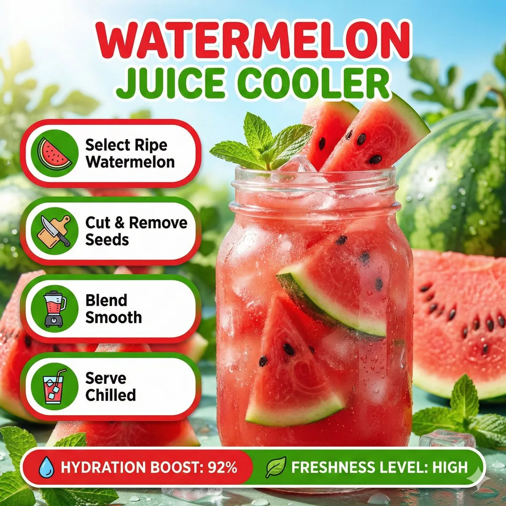

# Synthia — by @AIwithSynthia

[← Back to Examples from X](../../EXAMPLES.md) · Category: Poster Design · Model: `Nano Banana`

<a href="https://x.com/AIwithSynthia/status/2016432642951151894"></a>

Original post: **[@AIwithSynthia on X](https://x.com/AIwithSynthia/status/2016432642951151894)** · Creator: [Synthia](https://x.com/AIwithSynthia)

## Prompt

```text
Bright summer infographic showcasing watermelon juice, icy texture, watermelon wedges floating. Steps: 📷 Select Ripe Watermelon 📷 Cut & Remove Seeds 📷 Blend Smooth 📷 Serve Chilled Info Bar: Hydration Boost: 92% Freshness Level: High High-contrast red & green palette.
```

## Try it

Paste the prompt into **[vinano.ai](https://vinano.ai?utm_source=github&utm_medium=readme&utm_campaign=awesome-image-video-prompts-updating&utm_content=x-page-try)** to generate your own version.

> The image and prompt belong to [@AIwithSynthia](https://x.com/AIwithSynthia) and are shown here with credit for reference. Creators can ask for changes or removal by opening an issue.
