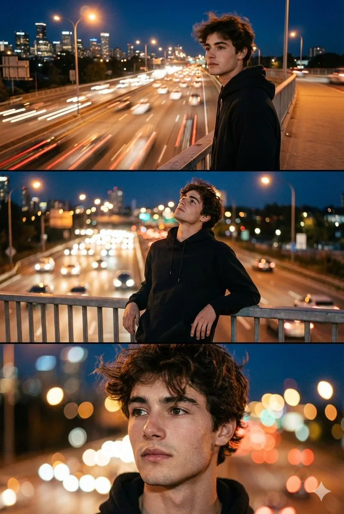

# Harboriis — by @harboriis

[← Back to Examples from X](../../EXAMPLES.md) · Category: Photography · Model: `Nano Banana`

<a href="https://x.com/harboriis/status/2015823640043151378"></a>

Original post: **[@harboriis on X](https://x.com/harboriis/status/2015823640043151378)** · Creator: [Harboriis](https://x.com/harboriis)

## Prompt

```text
use the uploaded photo as the exact identity reference. keep the same person, same face, same facial features, same proportions and natural expression, create a photorealistic cinematic triptych portrait (three-frame composition in one image).

scene: night city, bridge over a busy road, moving cars, glowing street lights, evening sky, city skyline in the background. atmosphere: freedom, motion, youth, urban romance, feeling of wind and road. frame 1 (top): wide cinematic shot - the person standing on a bridge above a busy road, slight motion blur from head movement, city lights and cars below, strong urban night mood. frame 2 (middle): medium shot person leaning on the bridge railing, looking up at the sky, relaxed confident pose, cars and headlights glowing behind. frame 3 (bottom): close-up emotional portrait wind in hair, city lights in bokeh behind, thoughtful and dreamy expression. style: real photography, cinematic lifestyle portrait, urban fashion photography. lighting, natural city night lighting, street lamps, car headlights, soft glow on skin. camera: full-frame dslr, 85mm lens look, shallow depth of field. color grading: warm city lights mixed with cool blue night tones, film-style mood. ultra photorealistic, natural skin texture, real candid moment, no illustration, no cgi, no plastic skin, no text, no logos, no watermark.
```

## Try it

Paste the prompt into **[vinano.ai](https://vinano.ai?utm_source=github&utm_medium=readme&utm_campaign=awesome-image-video-prompts-updating&utm_content=x-page-try)** to generate your own version.

> The image and prompt belong to [@harboriis](https://x.com/harboriis) and are shown here with credit for reference. Creators can ask for changes or removal by opening an issue.
