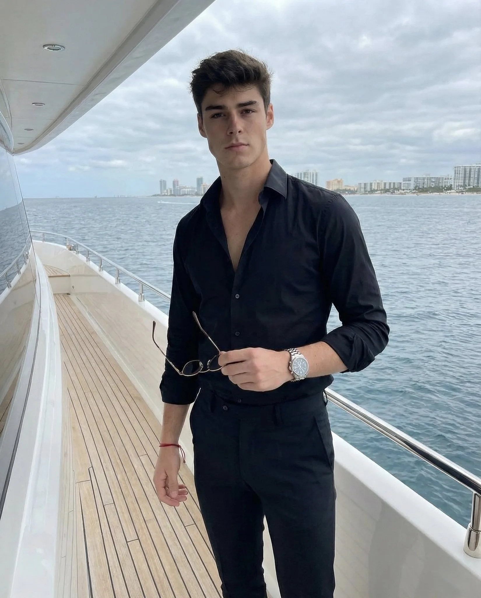

# Zara — by @ZaraIrahh

[← Back to Community Examples](../../EXAMPLES.md) · Category: Photography · Model: `Nano Banana`

<a href="https://x.com/ZaraIrahh/status/2008788225041838336"></a>

Source: **[@ZaraIrahh on X](https://x.com/ZaraIrahh/status/2008788225041838336)** · Creator: [Zara](https://x.com/ZaraIrahh)

## Prompt

```text
{ "composition": { "framing": "mid-length portrait from upper thighs to head", "orientation": "vertical", "camera_angle": "eye-level", "subject_position": "left third of the frame", "balance": "subject balanced against expansive seascape on the right", "depth": "moderate depth with clear foreground subject and distant cityscape background" }, "subject": { "gender_presentation": "male-presenting", "age_range": "young adult", "pose": "relaxed standing posture, torso slightly angled, head turned to the left", "expression": "neutral to contemplative", "gaze_direction": "looking on camera", "hair": { "color": "dark brown to black", "style": "thick, voluminous, tousled, slightly wavy" }, "skin_tone": "light to medium", "facial_features": "defined jawline, straight nose, full lips, clean-shaven" }, "clothing_and_accessories": { "top": { "type": "long-sleeve button-up shirt", "color": "black", "fit": "slim to regular fit", "details": "top buttons undone, lightweight fabric with subtle drape" }, "bottom": { "type": "trousers", "color": "dark navy or black", "fit": "slim fit" }, "accessories": [ { "item": "sunglasses", "color": "black", "held_in": "right hand" }, { "item": "wristwatch", "material": "metal", "worn_on": "left wrist" }, { "item": "bracelet", "color": "red", "worn_on": "right wrist" } ] }, "environment": { "setting": "outdoor, on a boat or waterfront deck", "foreground": "white deck surface", "background": { "elements": [ "open sea with visible water texture", "distant coastal cityscape", "cloud-filled sky" ], "horizon_line": "visible and level" } }, "lighting": { "type": "natural daylight", "quality": "soft and diffused", "direction": "overhead with slight frontal illumination", "shadows": "minimal, soft-edged" }, "color_palette": { "dominant_colors": [ "deep blue", "cyan", "white", "black" ], "contrast": "high contrast between dark clothing and bright environment", "saturation": "moderate, natural tones" }, "technical_characteristics": { "focus": "sharp focus on subject", "depth_of_field": "moderate, background slightly softened but recognizable", "image_clarity": "high", "noise": "minimal", "lens_effect": "no visible distortion, likely standard focal length" }, "artistic_style": { "aesthetic": "clean, modern lifestyle photography", "mood": "calm, confident, aspirational", "visual_theme": "luxury travel or leisure" }, "typography": { "text_present": false } }
```

## Try it

Paste the prompt into **[vinano.ai](https://vinano.ai?utm_source=github&utm_medium=readme&utm_campaign=awesome-image-video-prompts-updating&utm_content=x-page-try)** to generate your own version.

> The image and prompt belong to @ZaraIrahh ([original post](https://x.com/ZaraIrahh/status/2008788225041838336)) and are shown here with credit for reference. Creators can ask for changes or removal by opening an issue.
