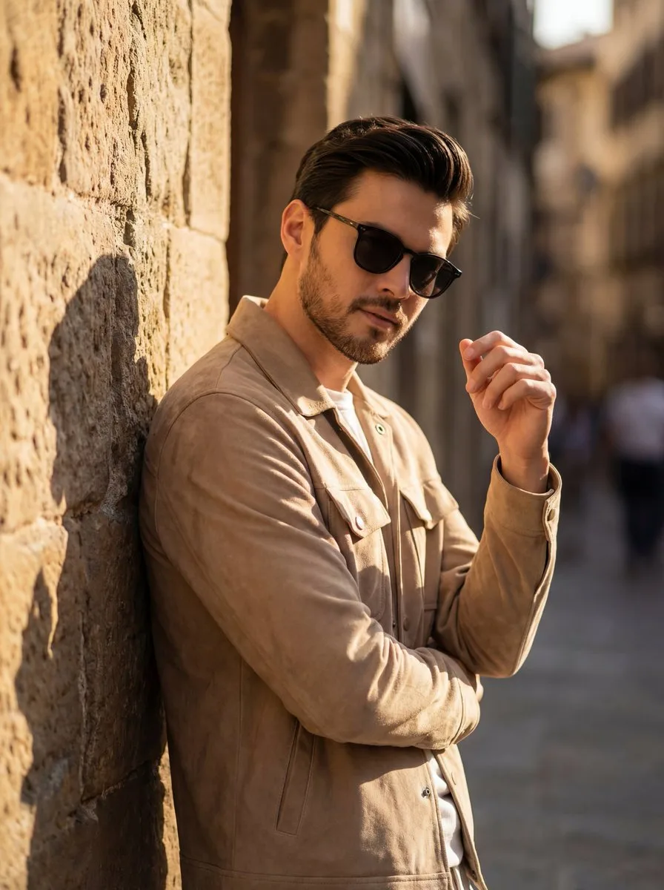

# Zara — by @ZaraIrahh

[← Back to Community Examples](../../EXAMPLES.md) · Category: Photography · Model: `Nano Banana`

<a href="https://x.com/ZaraIrahh/status/2024808774993694890"></a>

Source: **[@ZaraIrahh on X](https://x.com/ZaraIrahh/status/2024808774993694890)** · Creator: [Zara](https://x.com/ZaraIrahh)

## Prompt

```text
A cinematic golden hour portrait of a stylish man leaning against a textured stone wall, wearing dark sunglasses, a beige suede jacket with large front pockets, and a white crew-neck shirt underneath, warm sunlight casting sharp shadows across the wall, soft natural beard, well-groomed dark hair styled back, confident relaxed pose with one hand raised near his face, warm earthy color palette, strong side lighting, high contrast highlights and shadows, shallow depth of field, ultra-realistic fashion photography, editorial street style aesthetic, 85mm lens, f/2.0, crisp detail, natural skin tones, 4K resolution.
```

## Try it

Paste the prompt into **[vinano.ai](https://vinano.ai?utm_source=github&utm_medium=readme&utm_campaign=awesome-image-video-prompts-updating&utm_content=x-page-try)** to generate your own version.

> The image and prompt belong to @ZaraIrahh ([original post](https://x.com/ZaraIrahh/status/2024808774993694890)) and are shown here with credit for reference. Creators can ask for changes or removal by opening an issue.
