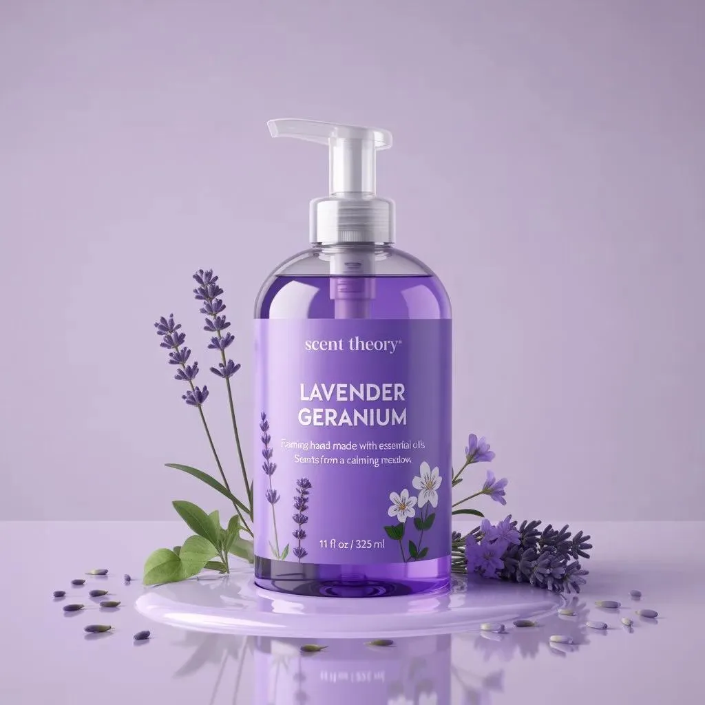

# Oogie — by @oggii_0

[← Back to Examples from X](../../EXAMPLES.md) · Category: Product & Brand · Model: `Nano Banana`

<a href="https://x.com/oggii_0/status/2026929094164885863"></a>

Original post: **[@oggii_0 on X](https://x.com/oggii_0/status/2026929094164885863)** · Creator: [Oogie](https://x.com/oggii_0)

## Prompt

```text
Use the uploaded image as the exact visual reference for product design, label, lavender placement, liquid color, milk puddle, and soft purple background .Camera Movement:Full 360° slow-motion orbit around the product.Smooth, steady circular motion.Constant speed .No shake .No sudden acceleration .No zoom in or out.Keep product centered at all times.Framing:Mid close-up product shot.Bottle remains perfectly upright and fixed in position.
```

## Try it

Paste the prompt into **[vinano.ai](https://vinano.ai?utm_source=github&utm_medium=readme&utm_campaign=awesome-image-video-prompts-updating&utm_content=x-page-try)** to generate your own version.

> The image and prompt belong to [@oggii_0](https://x.com/oggii_0) and are shown here with credit for reference. Creators can ask for changes or removal by opening an issue.
