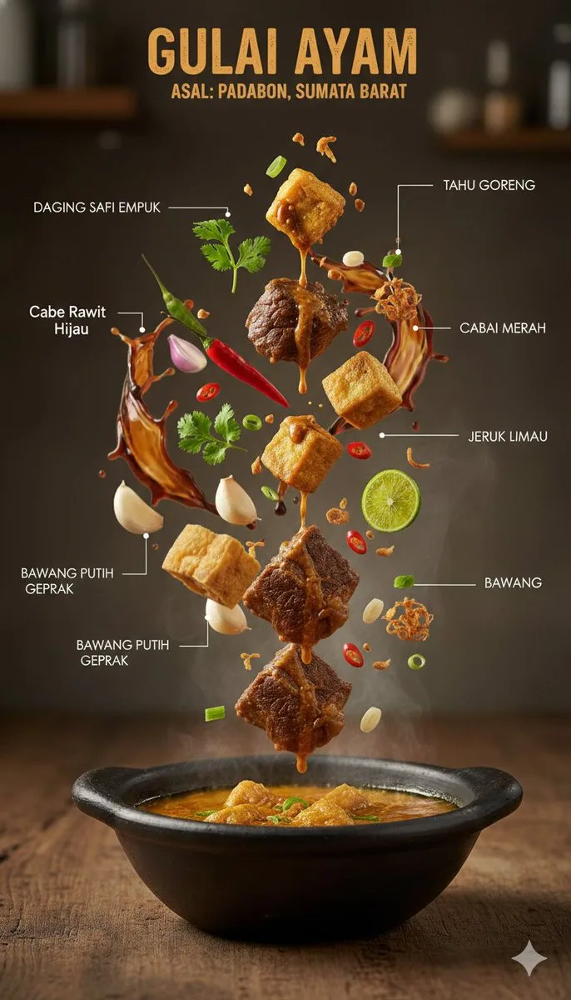

# Johnn — by @john_my07

[← Back to Examples from X](../../EXAMPLES.md) · Category: Food & Drink · Model: `Nano Banana`

<a href="https://x.com/john_my07/status/2018524475306938771"></a>

Original post: **[@john_my07 on X](https://x.com/john_my07/status/2018524475306938771)** · Creator: [Johnn](https://x.com/john_my07)

## Prompt

```text
{
  "image_prompt": {
    "type": "Ultra-realistic culinary infographic",
    "subject": {
      "cuisine": "Indonesian",
      "base_element": "A traditional serving bowl holding a steaming hot dish",
      "levitating_ingredients": [
        "Tender meat pieces",
        "Golden crispy tofu",
        "Rich sauce droplets in mid-air",
        "Fresh green herbs",
        "Red chilies",
        "Sliced lime",
        "Crushed garlic",
        "Crispy fried shallots"
      ]
    },
    "composition": {
      "layout": "Minimal, vertically stacked layout",
      "arrangement": "Ingredients floating naturally as if suspended in motion",
      "background": "Textured rustic wooden tabletop",
      "visual_hierarchy": "The bowl remains grounded at the base, with ingredients ascending above it"
    },
    "graphic_design_elements": {
      "labels": "Clean Indonesian-language annotations",
      "lines": "Fine white connector lines",
      "style": "High-end editorial food infographic, magazine-quality design"
    },
    "lighting_and_mood": {
      "lighting": "Controlled cinematic studio lighting",
      "color_palette": "Warm, appetizing color tones",
      "effects": "Visible steam and frozen-action food elements"
    },
    "technical_specs": {
      "camera_settings": "Shallow depth of field with crisp focal detail, DSLR-style capture",
      "details": "Extremely detailed surface textures",
      "resolution": "8K, photorealistic finish"
    }
  }
}
```

## Try it

Paste the prompt into **[vinano.ai](https://vinano.ai?utm_source=github&utm_medium=readme&utm_campaign=awesome-image-video-prompts-updating&utm_content=x-page-try)** to generate your own version.

> The image and prompt belong to [@john_my07](https://x.com/john_my07) and are shown here with credit for reference. Creators can ask for changes or removal by opening an issue.
