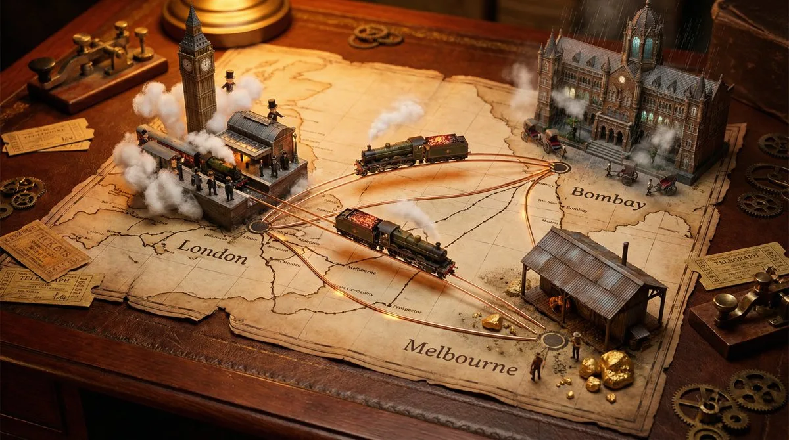

# Alexandra Aisling — by @AllaAisling

[← Back to Community Examples](../../EXAMPLES.md) · Category: Illustration & 3D · Model: `Nano Banana`

<a href="https://x.com/AllaAisling/status/2020546668295524791"></a>

Source: **[@AllaAisling on X](https://x.com/AllaAisling/status/2020546668295524791)** · Creator: [Alexandra Aisling](https://x.com/AllaAisling)

## Prompt

```text
A weathered {MAP_TYPE} map spread across {SURFACE}, bursting with photorealistic miniature worlds erupting from marked locations. {CITY_1} explodes from {CONTINENT} as a living diorama—{LANDMARK_1} towers above {STREET_SCENE}, surrounded by {ATMOSPHERIC_EFFECT} and {MOVING_ELEMENT}. {CITY_2} rises from {CONTINENT} with {LANDMARK_2} emerging through {WEATHER_DRAMA}, tiny {LOCAL_ACTIVITY} frozen mid-motion. {CITY_3} materializes from {CONTINENT} where {LANDMARK_3} pierces through {LIGHTING_EFFECT}, {CULTURAL_DETAIL} spilling across miniature streets. Connecting routes glow as {VISUAL_ELEMENT}—miniature {VEHICLE_TYPE} suspended impossibly between worlds. The map's surface transitions from flat parchment to living terrain: oceans become actual churning water with {WATER_DETAIL}, deserts shimmer with real heat haze, forests sprout miniature trees. Each city exists in its own time: {LIGHTING_CONDITION_1} bathes one, {LIGHTING_CONDITION_2} illuminates another, {LIGHTING_CONDITION_3} glows over the third. {FOREGROUND_OBJECTS} scatter around the map edges. {PHOTOGRAPHY_STYLE}, {COLOR_PALETTE}, extreme depth of field, 8K, {ERA_AESTHETIC} meets magical realism.
```

## Try it

Paste the prompt into **[vinano.ai](https://vinano.ai?utm_source=github&utm_medium=readme&utm_campaign=awesome-image-video-prompts-updating&utm_content=x-page-try)** to generate your own version.

> The image and prompt belong to @AllaAisling ([original post](https://x.com/AllaAisling/status/2020546668295524791)) and are shown here with credit for reference. Creators can ask for changes or removal by opening an issue.
