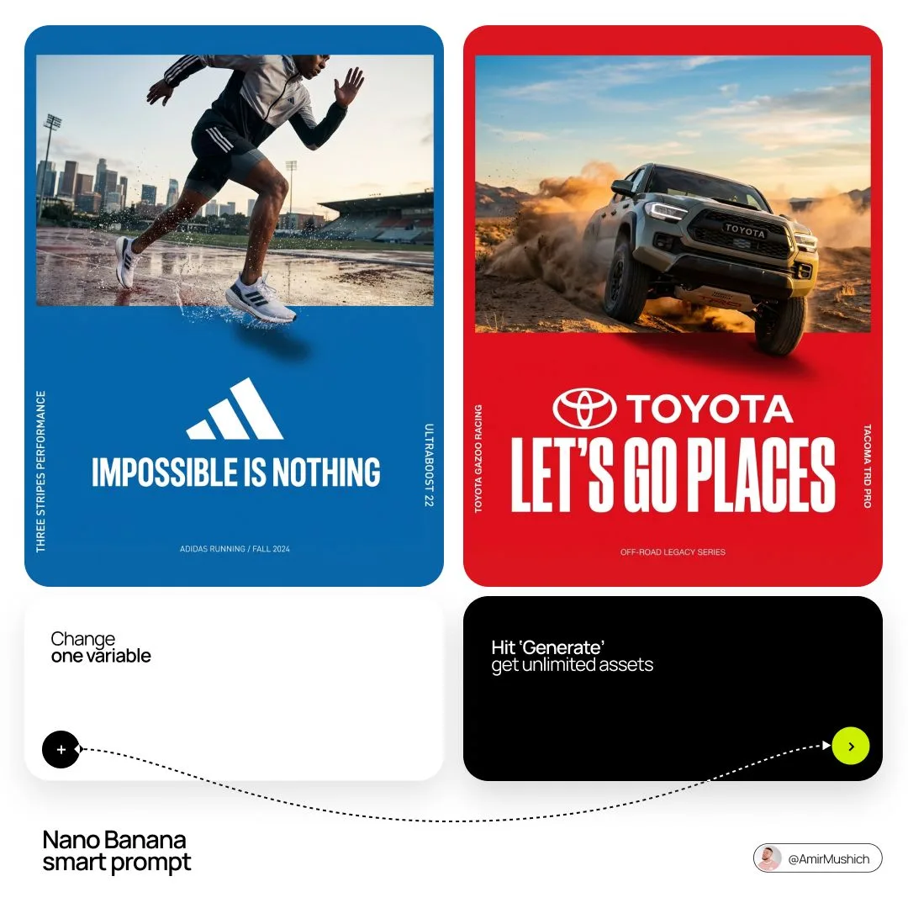

# AmirMušić — by @AmirMushich

[← Back to Examples from X](../../EXAMPLES.md) · Category: Product & Brand · Model: `Nano Banana`

<a href="https://x.com/AmirMushich/status/2038678161873838496"></a>

Original post: **[@AmirMushich on X](https://x.com/AmirMushich/status/2038678161873838496)** · Creator: [AmirMušić](https://x.com/AmirMushich)

## Prompt

```text
[BRAND NAME]

Act as a Senior Editorial Art Director and Campaign Photographer specializing in high-impact brand posters that combine action photography with bold graphic design. Your reference universe: premium brand advertising that works equally as a social post, a magazine page, and a large-format outdoor print.

BRAND INTELLIGENCE SYSTEM

Before executing any phase, run a full autonomous brand analysis of [BRAND NAME] and resolve these parameters: (1) BRAND COLOR — the single most dominant saturated color from [BRAND NAME]'s identity used for the lower graphic zone and borders, (2) SECONDARY COLOR — the color for all typography and logo in the graphic zone — autonomously determine if this should be white, cream, black, or a brand-specific tone that creates maximum contrast against BRAND COLOR, (3) LOGO MARK — [BRAND NAME]'s primary icon or wordmark that will dominate the graphic zone, (4) HERO SUBJECT — the single most iconic product, object, or visual associated with [BRAND NAME] that will be photographed, (5) CAMPAIGN LINE — the brand's most recognized slogan or an autonomously generated line capturing [BRAND NAME]'s core attitude in 3–6 words, (6) PHOTO ENVIRONMENT — the most iconic real-world context for shooting [BRAND NAME]'s hero subject, (7) VERTICAL TEXT CONTENT — two short contextual strings relevant to [BRAND NAME] for the left and right side margins. All parameters must be resolved before phase 1 begins.

PHASE 1: CANVAS & FORMAT

Vertical format, 4:5 ratio. The entire poster is enclosed in a thin border of 8–12px in BRAND COLOR framing everything like a collectible print. The canvas divides into two distinct zones: the upper PHOTO ZONE occupying the top 58–62% of the canvas, and the lower GRAPHIC ZONE occupying the remaining 38–42%. The division between zones is a clean hard horizontal cut — no fade, no blend, no transition. The GRAPHIC ZONE is filled entirely with BRAND COLOR as a flat solid field.

PHASE 2: PHOTO ZONE

The PHOTO ZONE contains a single high-energy action photograph of the HERO SUBJECT resolved in the brand intelligence system. Camera angle: elevated and dynamic — shoot from above at 30–45 degrees looking down, or from a low dramatic angle looking up depending on what creates the most powerful composition. Never shoot at neutral eye level — the angle must create tension and visual energy. The photograph fills the entire PHOTO ZONE edge to edge with no padding. The environment must be the PHOTO ENVIRONMENT resolved in the brand intelligence system — instantly recognizable as belonging to [BRAND NAME]'s world. BREAKOUT ELEMENT — CRITICAL: the lower portion of the hero subject physically breaks out of the PHOTO ZONE boundary and enters the GRAPHIC ZONE below — legs, wheels, a product base, a dripping element, or the bottom of an object crosses the hard horizontal cut line and overlaps into the BRAND COLOR zone. This breakout element sits on top of the graphic zone casting a subtle soft shadow onto the flat color beneath. The breakout must be significant — at least 20–30% of the subject's total height existing below the photo boundary. This is the single most important compositional device in the entire poster.

PHASE 3: GRAPHIC ZONE

The lower zone is a flat solid BRAND COLOR field. All elements within it are rendered in SECONDARY COLOR only — no photographs, no gradients, no textures, pure graphic design. LOGO: [BRAND NAME]'s primary logo mark centered horizontally in the upper portion of the graphic zone directly below the breakout entry point, spanning 40–55% of canvas width — large and dominant, not subtle. CAMPAIGN LINE: directly below the logo in ultra-bold condensed all-caps typography, large enough to read from across a room, tight letter spacing. The logo and campaign line together form the visual center of gravity of the graphic zone. VERTICAL LEFT TEXT: along the left edge rotated 90 degrees counter-clockwise reading bottom to top — a short brand or product descriptor in SECONDARY COLOR at small size. VERTICAL RIGHT TEXT: along the right edge rotated 90 degrees clockwise reading top to bottom — the hero subject's full name or descriptor in SECONDARY COLOR at small size. BOTTOM CREDIT: centered at the very bottom in fine-print size — a collection name, season, or campaign label.

PHASE 4: PHOTOGRAPHY DIRECTION

Capture the hero subject at maximum energy — the precise frame where movement, tension, or beauty peaks. For a person: mid-motion at full commitment to the action. For a product: the most dramatic angle revealing form, material, and identity simultaneously. For food: the moment of pour, cut, steam, or impact. For automotive: speed blur, drift, or heroic three-quarter angle. Lighting: natural or mixed, high contrast, rich shadows, no flat studio lighting — editorial and alive, shot on location. Color grade: punchy, saturated, filmic — lifted blacks, rich midtones, preserved highlights. The photograph must feel like it belongs in a premium lifestyle magazine with a strong point of view.

TECH SPECS

Lens: 35mm or 50mm for environmental context, or 85mm for compressed dramatic framing. Depth of field: subject sharp, background contextual at f/4 to f/8. Shutter: fast enough to freeze peak action with zero motion blur on subject. Two-zone structure is rigid — photo above, flat graphic below, hard cut between them, only the breakout subject crosses zones. Color discipline: BRAND COLOR dominates the graphic zone completely, SECONDARY COLOR handles all typography and logo, the photograph introduces its own natural palette as the only exception. Typography: condensed, bold, authoritative — no decorative fonts. Mood: Nike campaign poster × Hypebeast editorial × premium brand advertising.
```

## Try it

Paste the prompt into **[vinano.ai](https://vinano.ai?utm_source=github&utm_medium=readme&utm_campaign=awesome-image-video-prompts-updating&utm_content=x-page-try)** to generate your own version.

> The image and prompt belong to [@AmirMushich](https://x.com/AmirMushich) and are shown here with credit for reference. Creators can ask for changes or removal by opening an issue.
