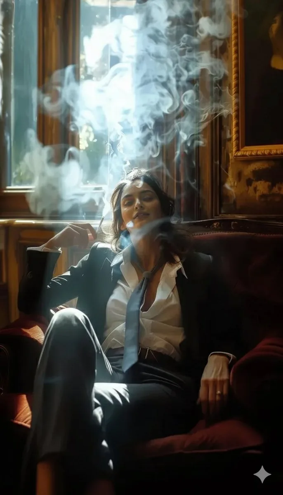

# Aijaz — by @iamsofiaijaz

[← Back to Community Examples](../../EXAMPLES.md) · Category: Photography · Model: `Nano Banana`

<a href="https://x.com/iamsofiaijaz/status/2016007845410701687"></a>

Source: **[@iamsofiaijaz on X](https://x.com/iamsofiaijaz/status/2016007845410701687)** · Creator: [Aijaz](https://x.com/iamsofiaijaz)

## Prompt

```text
​A high-definition cinematic portrait of a sophisticated woman sitting in a plush, velvet burgundy armchair within a sunlit, vintage study. She is wearing a sharp black tailored suit, a crisp white button-down shirt slightly unbuttoned, and a loosely tied charcoal grey necktie. She holds a cigarette, with thick, ethereal plumes of white smoke swirling dramatically around her face and rising toward the ceiling. The lighting is dramatic "chiaroscuro" style, with bright sunlight streaming through a large window behind her, creating a glowing rim light on her hair and the smoke. The background features ornate wooden wall panels and a classic framed painting. Photorealistic, 8k resolution, moody atmosphere.
​Tips for Best Results:
​Aspect Ratio: If your tool supports it, use --ar 9:16 to get that tall, vertical phone-wallpaper look.
​Lighting Keywords: Using terms like "volumetric lighting" or "backlit" will help emphasize the way the light interacts with the smoke.
​Style: If you want it to look more like a movie still, add "shot on 35mm film" to the end.
```

## Try it

Paste the prompt into **[vinano.ai](https://vinano.ai?utm_source=github&utm_medium=readme&utm_campaign=awesome-image-video-prompts-updating&utm_content=x-page-try)** to generate your own version.

> The image and prompt belong to @iamsofiaijaz ([original post](https://x.com/iamsofiaijaz/status/2016007845410701687)) and are shown here with credit for reference. Creators can ask for changes or removal by opening an issue.
