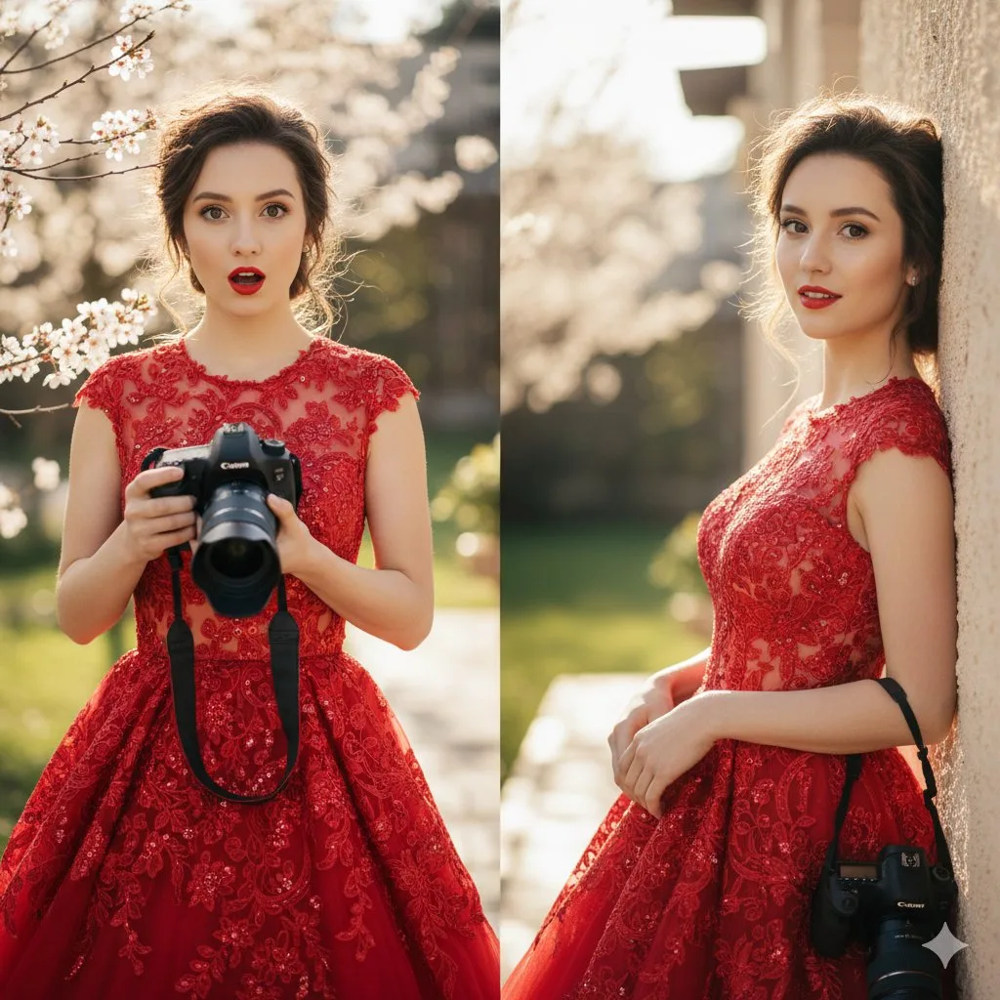

# Minahil — by @Minahil42298354

[← Back to Community Examples](../../EXAMPLES.md) · Category: Photography · Model: `Nano Banana`

<a href="https://x.com/Minahil42298354/status/2025148839301091523"></a>

Source: **[@Minahil42298354 on X](https://x.com/Minahil42298354/status/2025148839301091523)** · Creator: [Minahil](https://x.com/Minahil42298354)

## Prompt

```text
A young woman with an elegant, polished look. In one frame, she has an expressive, surprised "O" face; in the other, a soft, confident smile.
​Attire: A vibrant crimson red floor-length gown featuring intricate floral lace embroidery, a sheer neckline, and subtle sequin detailing that catches the light.
​Hair & Makeup: Her hair is styled in a soft, romantic updo with loose tendrils. She wears bold red lipstick that perfectly matches her dress and classic, warm-toned eye makeup.
​Setting & Composition:
​Environment: An outdoor garden during golden hour. The background is filled with soft-focus white spring blossoms (like cherry or almond trees) and lush greenery.
​Lighting: Backlit by a warm, setting sun, creating a "halo" effect on her hair and a soft, ethereal glow across the scene.
​The Contrast: She is holding or wearing a professional black DSLR camera with a large lens. The mechanical, matte-black texture of the camera creates a sharp contrast against the delicate, red lace of the evening gown.
​Technical Details:
​Photography Style: Cinematic portraiture with a shallow depth of field (bokeh), making the subject pop against the blurred garden background.
​Composition: A side-by-side diptych showing two different poses: one front-facing and playful, one profile-view and serene.
```

## Try it

Paste the prompt into **[vinano.ai](https://vinano.ai?utm_source=github&utm_medium=readme&utm_campaign=awesome-image-video-prompts-updating&utm_content=x-page-try)** to generate your own version.

> The image and prompt belong to @Minahil42298354 ([original post](https://x.com/Minahil42298354/status/2025148839301091523)) and are shown here with credit for reference. Creators can ask for changes or removal by opening an issue.
