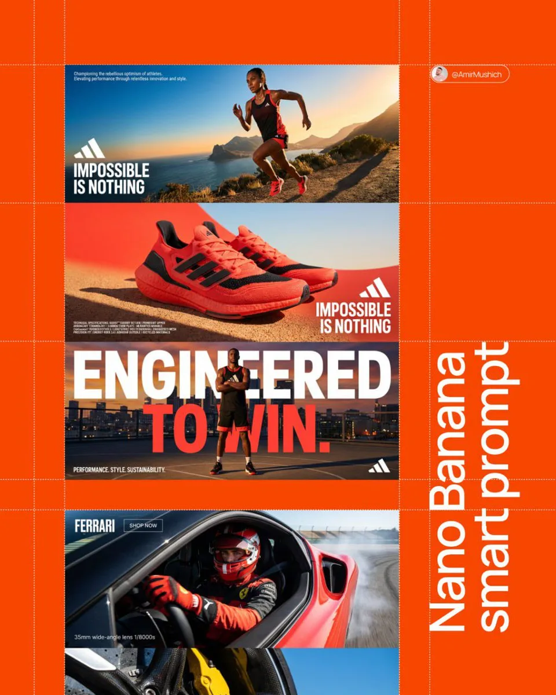

# AmirMušić — by @AmirMushich

[← Back to Community Examples](../../EXAMPLES.md) · Category: Product & Brand · Model: `Nano Banana`

<a href="https://x.com/AmirMushich/status/2029294395384574292"></a>

Source: **[@AmirMushich on X](https://x.com/AmirMushich/status/2029294395384574292)** · Creator: [AmirMušić](https://x.com/AmirMushich)

## Prompt

```text
[BRAND NAME]. Act as a Senior AI Visual Strategist & Creative Director.
Goal: Analyze the provided [BRAND NAME] and generate a high-end, three-panel vertical manifesto stack. Every element (color, slogan, technical text) must be a logical derivative of the brand's identity.

PHASE 1: AUTONOMOUS BRAND ANALYSIS (INTERNAL SIMULATION)
- Identify the core industry of "[BRAND NAME]".
- Select a high-contrast primary color for the background (e.g., Electric Blue, Racing Red, or Titanium White).
- Generate a powerful 3-word slogan and a 2-line brand philosophy description.
- Generate a block of 5 technical specifications/keywords relevant to the brand's premium products.

PHASE 2: COMPOSITIONAL STRUCTURE (THE VERTICAL STACK)
Layout consists of three wide horizontal panels stacked vertically:
TOP PANEL (Action & Identity): A dynamic wide-angle shot of a professional model using the brand's product.
   - Typography (Mid-Left): Place [BRAND NAME] logo and the 3-word slogan in bold white uppercase sans-serif.
   - Micro-Typography (Top-Left corner): Place the 2-line brand philosophy in a tiny, minimalist font.
MIDDLE PANEL (The Hero Product & Density): A macro close-up focus on the product's high-fidelity details.
   - Typography (Mid-Right): Place [BRAND NAME] logo and the slogan here to create a diagonal visual flow from the top panel.
   - Technical Density (Bottom-Left corner): Add the 5 technical specifications in sharp, microscopic uppercase font to create a "technical blueprint" aesthetic and fill the negative space.
BOTTOM PANEL (The Power Pose): A low-angle "hero shot" of the model.
   - Mega-Typography: Two massive, high-contrast slogans in white bold sans-serif overlaid across the center of the frame.
   - Corner Accents: A small brand icon in the bottom-right; a secondary micro-text in the bottom-left corner.

PHASE 3: LIGHTING & TEXTURE STANDARDS
- Lighting: Hard, direct "High-Noon" sunlight creating crisp, sharp-edged shadows and brilliant highlights (Chiaroscuro).
- Textures: Extreme fidelity in skin pores, fabric weaves (tech-mesh, leather, carbon fiber), and precision-engineered materials. Zero "AI-plastic" look.

PHASE 4: TECH SPECS
8K Resolution. Render: Octane/Redshift. Global Illumination. Ray Traced reflections. Cinematic photo grain.
```

## Try it

Paste the prompt into **[vinano.ai](https://vinano.ai?utm_source=github&utm_medium=readme&utm_campaign=awesome-image-video-prompts-updating&utm_content=x-page-try)** to generate your own version.

> The image and prompt belong to @AmirMushich ([original post](https://x.com/AmirMushich/status/2029294395384574292)) and are shown here with credit for reference. Creators can ask for changes or removal by opening an issue.
