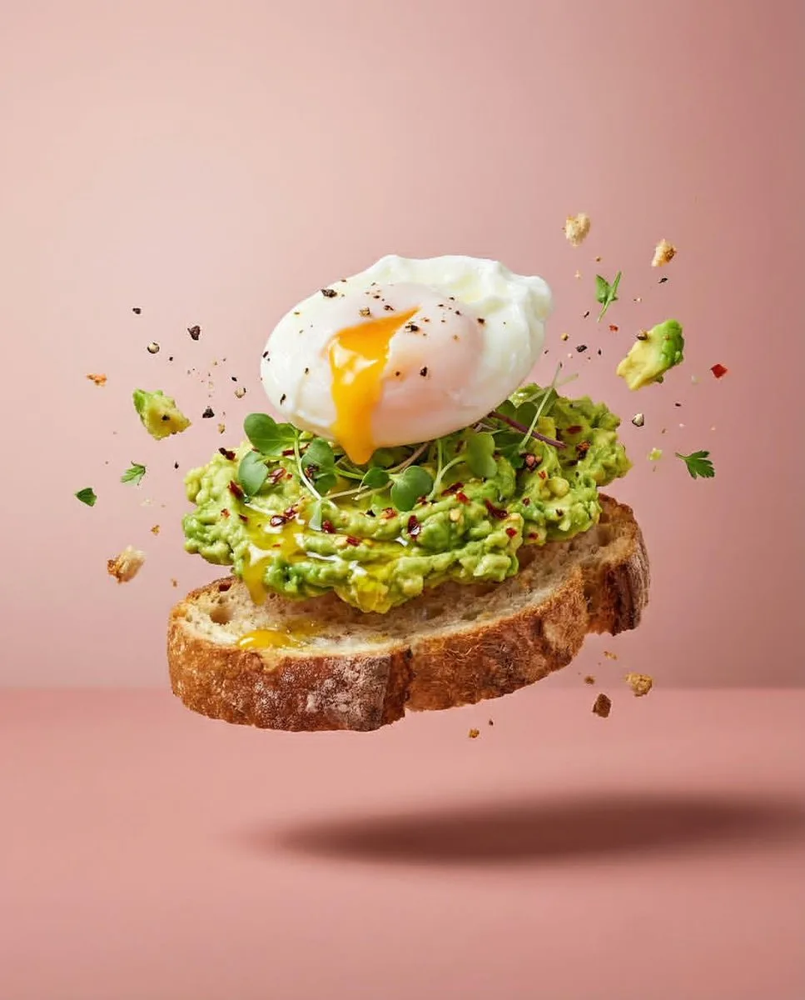

# Oogie — by @oggii_0

[← Back to Community Examples](../../EXAMPLES.md) · Category: Food & Drink · Model: `Nano Banana`

<a href="https://x.com/oggii_0/status/2013488775356391702"></a>

Source: **[@oggii_0 on X](https://x.com/oggii_0/status/2013488775356391702)** · Creator: [Oogie](https://x.com/oggii_0)

## Prompt

```text
Professional studio food photography series featuring deconstructed dishes in high-speed levitation. Against a seamless dusty pink background with soft, diffused studio lighting, ingredients float and explode dynamically. Subjects include a hovering stack of tiramisu components (gelato, ladyfingers, mascarpone, coffee beans), borscht ingredients (beets, rye bread, herbs) suspended above a ceramic bowl of soup on a wooden board, and sourdough toast with mashed avocado and a runny poached egg separating in mid-air. Capture fine details like flying crumbs, spice particles, herbs, and liquid droplets with sharp focus and a shallow depth of field. A soft shadow is cast beneath the main floating elements.
```

## Try it

Paste the prompt into **[vinano.ai](https://vinano.ai?utm_source=github&utm_medium=readme&utm_campaign=awesome-image-video-prompts-updating&utm_content=x-page-try)** to generate your own version.

> The image and prompt belong to @oggii_0 ([original post](https://x.com/oggii_0/status/2013488775356391702)) and are shown here with credit for reference. Creators can ask for changes or removal by opening an issue.
