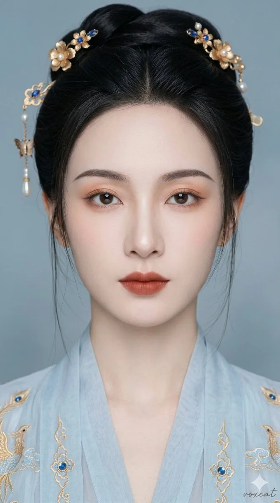

# VoxCat — by @VoxcatAI

[← Back to Examples from X](../../EXAMPLES.md) · Category: Photography · Model: `Nano Banana`

<a href="https://x.com/VoxcatAI/status/2037809608794759408"></a>

Original post: **[@VoxcatAI on X](https://x.com/VoxcatAI/status/2037809608794759408)** · Creator: [VoxCat](https://x.com/VoxcatAI)

## Prompt

```text
东方古风清雅女性正面肖像，超近景贴脸特写，人物正面面对镜头，头部端正，视线直视镜头，脸部几乎充满画面，构图集中，双眼位于视觉中心，整体呈现强烈的人脸主导感。
人物气质清雅、端庄、疏离、含蓄，像高门贵女、仙门弟子、带距离感的古典仕女，安静中带一种不容轻犯的从容。整体观感干净、精致、高级，不做甜美活泼感，不做冷艳危险感，不做现代时尚感。
脸型为窄长鹅蛋脸，脸宽较窄，纵向比例偏长，面中舒展，整体轮廓收紧修长，面部留白适中。额头中等偏高，发际线整齐、轮廓饱满流畅。太阳穴平顺微内收但不凹陷，颧弓不外扩，苹果肌轻微平整，不做甜感饱满苹果肌，面中过渡平整流畅，鼻基底适中，法令区干净。下颌线柔和但走向清晰，下颌角弱化，下巴中等长度偏尖，收口利落精致，骨相轻薄修长，上镜感强。
五官精致古典。眉毛为深棕色自然弯眉，眉形柔弧流畅，眉峰轻微自然，眉尾细而下收，眉眼距离适中偏宽，整体呈现古典温柔感。眼睛为细长杏眼偏凤眼感，双眼对称，眼裂偏长，纵向开合中等偏窄，内眼角略尖清晰，外眼角向外轻微上挑，上眼皮薄而干净，双眼皮窄自然，下眼睑存在感清晰，卧蚕轻微精致不膨胀。眼神直视镜头，目光安静、清澈、疏离、端庄，带轻微不可接近感，不做甜妹无辜感，不做冷艳攻击感。睫毛纤长自然，上睫毛柔和拉长，下睫毛纤细分明，不做夸张浓密效果。鼻子为高挺秀气鼻，山根中等偏高自然顺接额头，鼻梁细直干净，鼻背平整挺拔，鼻头小巧精致微圆，鼻尖轻收，鼻翼窄，鼻孔不外露，中轴稳定，东方精致感，不做夸张欧美高挺鼻。嘴唇为中等厚度唇，唇峰清晰柔和，上唇中等，下唇微饱满，唇形端庄古典，嘴角自然平直，不做甜美嘟唇，不做大笑表情。
皮肤为冷白瓷感肤色，白皙通透匀净，底妆为高完成度瓷感底妆，肤质统一干净，细腻柔滑如上釉瓷器，带高级精修感。面中、鼻梁、鼻尖、眼下有轻微提亮，高光克制细腻，不做韩系油亮水光肌。面部轮廓修容精细但克制，鼻侧影自然，颧侧轻微收紧，下颌修容干净，立体度来自柔和明暗关系而不是夸张硬阴影。
妆容为古风仕女感精致妆容，明确带妆，妆感温暖古典。眼妆以暖橘棕、柔和赤茶、浅珊瑚为主色调，上眼影从睫毛根部向上柔和晕染，色彩干净通透，内眼线轻微填满，外眼线纤细柔和向外轻微拉长，眼尾上扬幅度极克制，下眼睑后半段极轻微暖橘晕染，下睫毛纤细分明，卧蚕以窄面积柔和提亮呈现，不做甜妹膨胀卧蚕。眉妆自然克制，色调与发色协调。腮红为柔和暖杏橘色，位置偏面中偏高，存在感低，自然融入肤色。唇妆为中饱和暖红棕、柔和赤茶调，中心略深边缘柔化，唇面保留轻微质感，整体妆容温暖古典、清雅内敛。
发型为黑色盘发古风发髻，发缝自然偏分，发质顺滑，发量适中偏多，头顶盘成精致高髻，两侧有少量碎发自然垂落修饰脸型，额前轻微碎发但不遮挡眉眼主体。发顶轮廓干净圆润。可搭配低调古风发饰，如蓝宝石花簪、金丝蝶饰、小型珠坠流苏，风格雅致精致，不夸张不繁重，与衣饰色调统一。
服饰为浅蓝色至雾蓝色古风广袖衣裳，面料轻透柔软，带轻纱层叠感，肩颈区域布料自然垂落，领口结构精致干净。面料上可见精致金色凤鸟纹刺绣，纹饰繁复但不凌乱，金线细腻闪烁，局部点缀蓝宝石色小型珠饰。整体造型统一于仙门贵女、古典仕女方向。
光线为柔和均匀正面布光，主光正面略偏上打在额头、眼周、鼻梁、唇部，让脸部中央清晰，五官干净立体。光线均匀柔和，不做强烈明暗对比。整体色调偏冷中性偏蓝灰，背景为柔和雾蓝灰色虚化，与服饰色调形成统一色境。人物肤色保持自然冷白，唇部保留暖红棕形成轻微冷暖对比。画面具有影视级真实摄影质感，细节干净，高级精修，非卡通，非插画，非二次元，偏真实摄影与古风写真效果。
画面仅聚焦于面部、五官、皮肤、妆容、发型与服饰本身，不加入场景信息，不加入动作叙事，不加入手部，不加入背景道具，不加入文字信息。极近景贴脸特写，面部填满画面，正面直视。不做侧脸，不做低头俯视，不做仰拍。非卡通，非插画，非二次元，非3D渲染。
在画面右下角加入专属签名"voxcat"，签名形式为小型自然手写英文签名，笔触干净利落，尺寸较小，不抢主体，不破坏整体构图，与画面古风清雅气质统一；签名颜色可为低饱和白色、灰白色或淡金色，具有高级感与作品标识感。
```

## Try it

Paste the prompt into **[vinano.ai](https://vinano.ai?utm_source=github&utm_medium=readme&utm_campaign=awesome-image-video-prompts-updating&utm_content=x-page-try)** to generate your own version.

> The image and prompt belong to [@VoxcatAI](https://x.com/VoxcatAI) and are shown here with credit for reference. Creators can ask for changes or removal by opening an issue.
