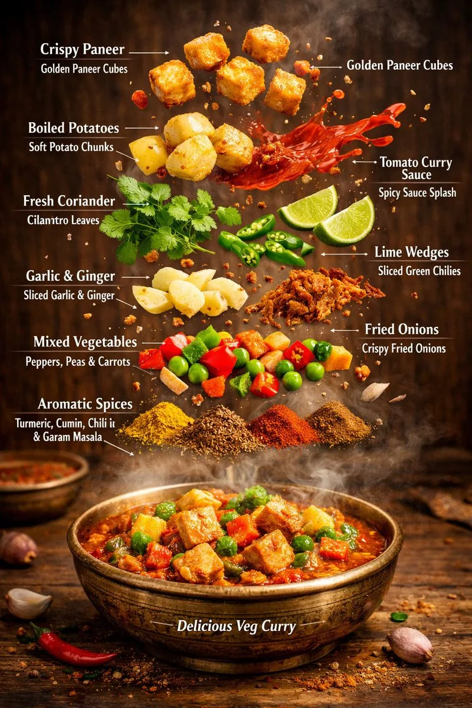

# Cherry 2.O — by @Mind_Boticni

[← Back to Examples from X](../../EXAMPLES.md) · Category: Food & Drink · Model: `Nano Banana`

<a href="https://x.com/Mind_Boticni/status/2019418461869650379"></a>

Original post: **[@Mind_Boticni on X](https://x.com/Mind_Boticni/status/2019418461869650379)** · Creator: [Cherry 2.O](https://x.com/Mind_Boticni)

## Prompt

```text
{
  "image_prompt": {
    "type": "Hyper-realistic editorial food infographic",
    "subject": {
      "cuisine": "Authentic Indian Vegetarian",
      "base_element": "Traditional rustic bowl filled with steaming, freshly cooked curry at the bottom, rich and aromatic",
      "levitating_ingredients": [
        "Golden, crispy paneer cubes",
        "Soft boiled potato chunks",
        "Glazed tomato-curry sauce splashes suspended mid-air",
        "Vibrant fresh coriander leaves",
        "Sliced green chilies",
        "Lime wedges",
        "Thin slices of garlic and ginger",
        "Crunchy fried onions",
        "Colorful vegetables: red bell peppers, green peas, orange carrots",
        "Sprinkle of aromatic spices: turmeric, cumin seeds, red chili powder, garam masala"
      ]
    },
    "composition": {
      "layout": "Clean vertical infographic composition",
      "arrangement": "Realistic gravity-defying floating ingredients, layered for visual hierarchy",
      "background": "Warm rustic wooden tabletop or traditional Indian brass plate",
      "visual_hierarchy": "Bowl anchored at the bottom, ingredients rising vertically with natural spacing, creating depth and focus on main dish"
    },
    "graphic_design_elements": {
      "labels": "Sharp, clear English text annotations for each ingredient",
      "lines": "Delicate thin white pointer lines connecting floating ingredients to labels",
      "style": "Professional editorial food magazine infographic, visually educational, vibrant and appetizing"
    },
    "lighting_and_mood": {
      "lighting": "Cinematic studio lighting with warm highlights and soft shadows, enhancing textures",
      "color_palette": "Rich, vibrant warm tones to highlight spices, vegetables, and curry",
      "effects": "Visible rising steam, motion-frozen mid-air ingredients, slight reflections and glistening sauce for mouth-watering effect"
    },
    "technical_specs": {
      "camera_settings": "Shallow depth of field, ultra-sharp focus on foreground elements, DSLR cinematic lens effect",
      "details": "Ultra-detailed textures on paneer, vegetables, spices, and sauce; realistic steam and glossy highlights",
      "resolution": "8K ultra-realistic, suitable for high-end digital display, print, or magazine cover"
    }
  }
}
```

## Try it

Paste the prompt into **[vinano.ai](https://vinano.ai?utm_source=github&utm_medium=readme&utm_campaign=awesome-image-video-prompts-updating&utm_content=x-page-try)** to generate your own version.

> The image and prompt belong to [@Mind_Boticni](https://x.com/Mind_Boticni) and are shown here with credit for reference. Creators can ask for changes or removal by opening an issue.
