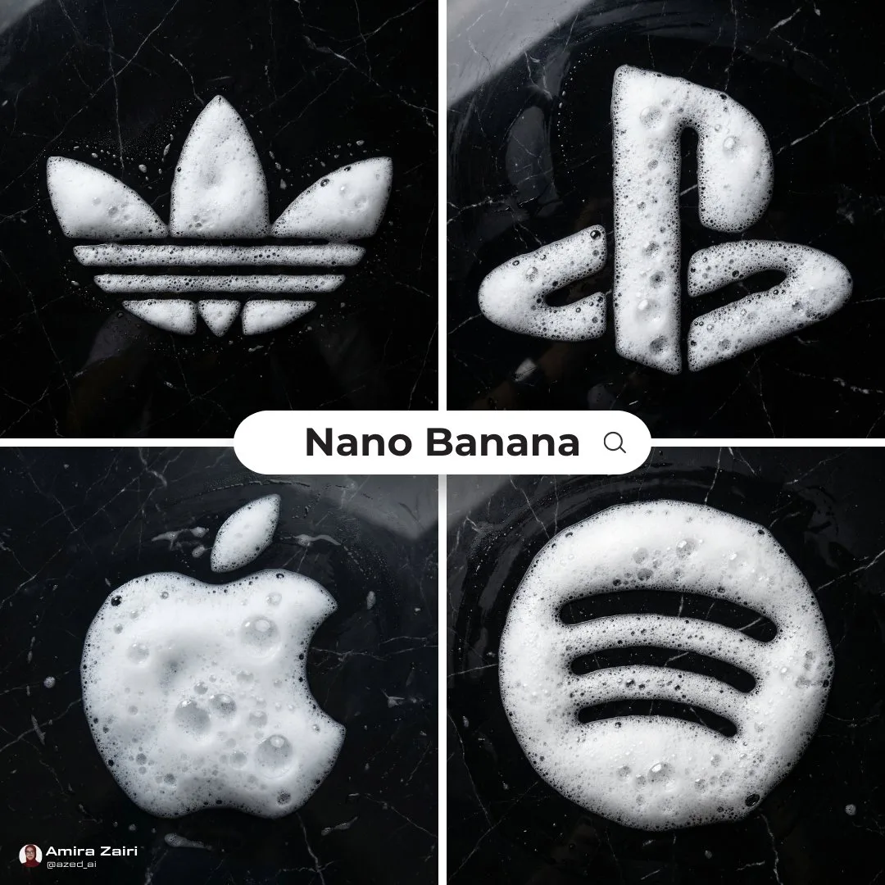

# Amira Zairi — by @azed_ai

[← Back to Examples from X](../../EXAMPLES.md) · Category: Product & Brand · Model: `Nano Banana`

<a href="https://x.com/azed_ai/status/2025933939647586694"></a>

Original post: **[@azed_ai on X](https://x.com/azed_ai/status/2025933939647586694)** · Creator: [Amira Zairi](https://x.com/azed_ai)

## Prompt

```text
Ultra-realistic top-down photograph of detergent foam forming a precise [subject / logo / symbol / shape] on a polished black marble surface. Thick, airy white foam with realistic bubbles of varying sizes, natural translucency, wet shine, and soft highlights. Foam appears freshly formed, slightly uneven at the edges, physically accurate, volumetric, and naturally settled on the marble.

Black marble background with subtle white veining, glossy finish, realistic reflections and moisture marks, high contrast between white foam and dark stone. Clean minimalist composition, centered subject.

Soft diffused overhead lighting creating gentle reflections on the marble and delicate shadows within the foam bubbles. Photorealistic texture detail, macro-level realism, high-end commercial photography style, no text overlays, no illustrations, no stylization, no CGI look, ultra-clean aesthetic, sharp focus, 8k resolution, 1:1
```

## Try it

Paste the prompt into **[vinano.ai](https://vinano.ai?utm_source=github&utm_medium=readme&utm_campaign=awesome-image-video-prompts-updating&utm_content=x-page-try)** to generate your own version.

> The image and prompt belong to [@azed_ai](https://x.com/azed_ai) and are shown here with credit for reference. Creators can ask for changes or removal by opening an issue.
