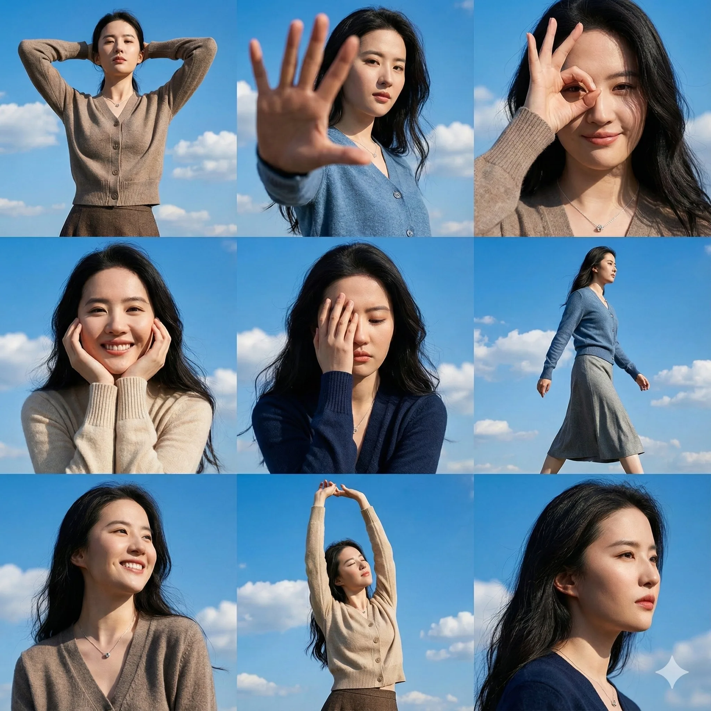

# xiaobeiLin(小北) — by @linxiaobei888

[← Back to Community Examples](../../EXAMPLES.md) · Category: Photography · Model: `Nano Banana`

<a href="https://x.com/linxiaobei888/status/2009425516638687431"></a>

Source: **[@linxiaobei888 on X](https://x.com/linxiaobei888/status/2009425516638687431)** · Creator: [xiaobeiLin(小北)](https://x.com/linxiaobei888)

## Prompt

```text
一张高分辨率的3x3网格照片拼贴，包含九个不同的动态姿势，以上传的女性面部照片为参考，背景是充满活力的蔚蓝天空，点缀着朵朵白云，强烈的明暗自然阳光照射下，形成清晰的阴影。人物身穿针织衫，搭配一条裙子，并佩戴一条纤细的银项链。摄影运用了多种焦距，从35mm广角全身镜头到85mm特写人像镜头，画面切换自如。姿势丰富多样，包括：双腿分开、双手抱头的有力姿势；手掌直指镜头的透视效果；透过一只眼睛上方“OK”手势的俏皮特写；双手托腮的欢快中景；以及用手遮住半张脸的忧郁姿势。图像质量高达 8K 分辨率，呈现出超逼真的效果，展现了细腻的肌肤纹理、次表面散射、逼真的衣物褶皱以及根根分明的发丝，呈现出高端商业时尚画册或生活方式宣传片的精致美感。
```

## Try it

Paste the prompt into **[vinano.ai](https://vinano.ai?utm_source=github&utm_medium=readme&utm_campaign=awesome-image-video-prompts-updating&utm_content=x-page-try)** to generate your own version.

> The image and prompt belong to @linxiaobei888 ([original post](https://x.com/linxiaobei888/status/2009425516638687431)) and are shown here with credit for reference. Creators can ask for changes or removal by opening an issue.
