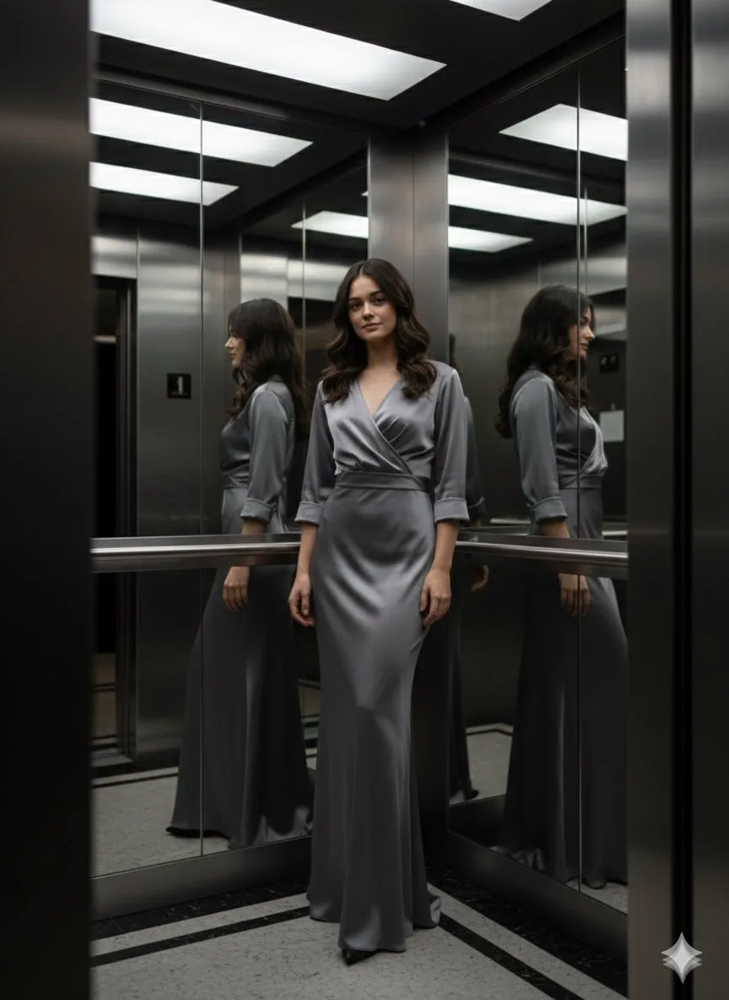

# Hoor — by @hoor_world06

[← Back to Community Examples](../../EXAMPLES.md) · Category: Photography · Model: `Nano Banana`

<a href="https://x.com/hoor_world06/status/2008566343147126894"></a>

Source: **[@hoor_world06 on X](https://x.com/hoor_world06/status/2008566343147126894)** · Creator: [Hoor](https://x.com/hoor_world06)

## Prompt

```text
{
  "render_goal": "Contemporary cinematic fashion portrait",
  "subject": {
    "pose": "female standing inside a luxury elevator",
    "expression": "subtle confident smile"
  },
  "wardrobe": "sleek satin gown in muted graphite tone",
  "environment": {
    "location": "brushed metal elevator interior",
    "props": "soft ceiling lights, mirror reflections"
  }
}
```

## Try it

Paste the prompt into **[vinano.ai](https://vinano.ai?utm_source=github&utm_medium=readme&utm_campaign=awesome-image-video-prompts-updating&utm_content=x-page-try)** to generate your own version.

> The image and prompt belong to @hoor_world06 ([original post](https://x.com/hoor_world06/status/2008566343147126894)) and are shown here with credit for reference. Creators can ask for changes or removal by opening an issue.
