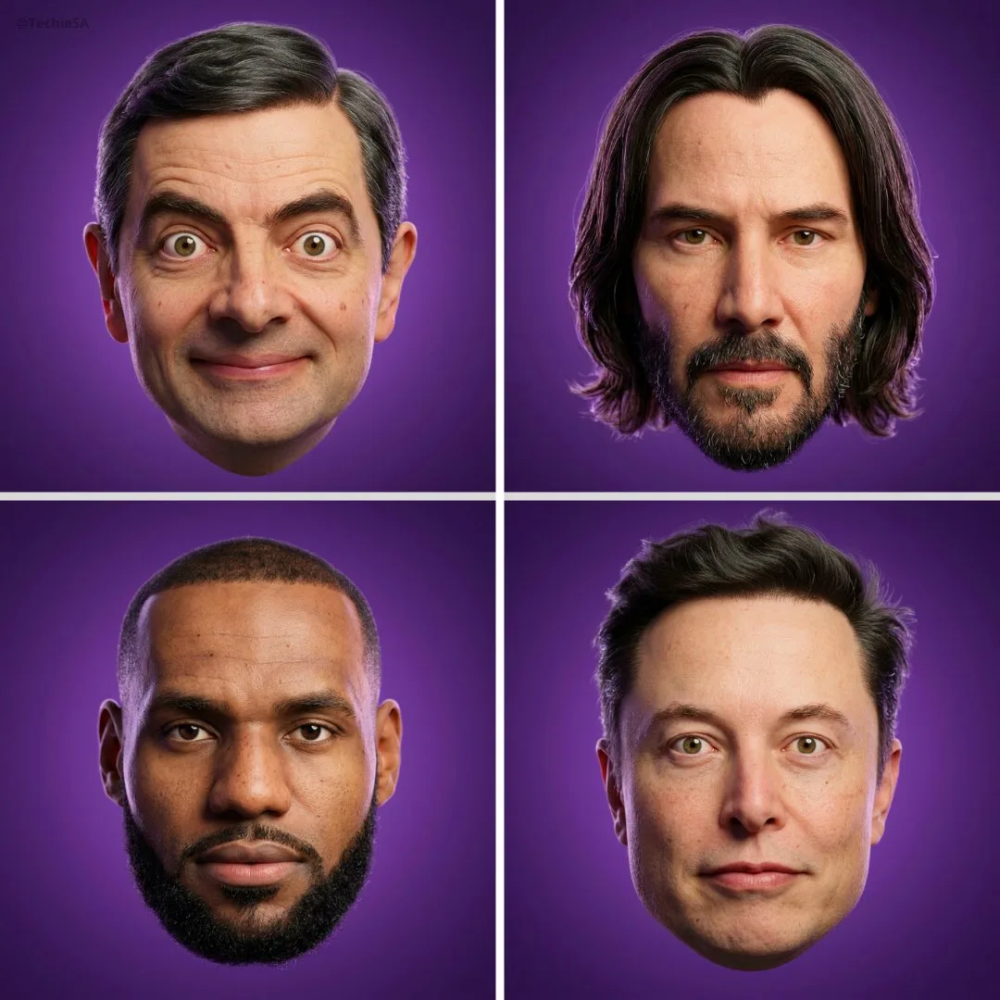

# TechieSA — by @TechieBySA

[← Back to Community Examples](../../EXAMPLES.md) · Category: Illustration & 3D · Model: `Nano Banana`

<a href="https://x.com/TechieBySA/status/2034967465487163740"></a>

Source: **[@TechieBySA on X](https://x.com/TechieBySA/status/2034967465487163740)** · Creator: [TechieSA](https://x.com/TechieBySA)

## Prompt

```text
Ultra-detailed stylized 3D portrait using the provided reference photo lebron james as the exact facial base.
Preserve the person perfectly — identical face shape, bone structure, jawline, eyes, nose, lips, skin tone, marks, freckles, expression and proportions.
DO NOT modify facial identity in any way.
Convert ONLY into high-end stylized 3D realism.
Head & elements:
Floating head only (no neck, no shoulders, no body)
Keep EXACTLY whatever the person has on their head in the reference image — same hairstyle, same hair length and texture, same hat, cap, sunglasses, glasses, headphones or any accessory. Do not remove or add anything.
Skin refinement:
Natural smooth skin (not plastic).Visible realistic micro-texture and pores. Subtle subsurface scattering for natural light diffusion. Soft highlights on cheekbones, nose bridge and tip.Balanced realistic shadows for depth
Hair & accessories (if present in reference):
Ultra-realistic volumetric strands.Natural shine and soft rim reflections. Perfectly preserved shape and position
Lighting:
Strong cinematic purple ambient background. Soft frontal key light evenly illuminating the face. Subtle rim light separating head from background. Gentle under-chin shadow for depth. Smooth light gradients, no harsh contrast
Rendering style:
Premium Pixar-quality stylized realism. Clean smooth shading. Global illumination. Soft bloom on highlights. Ultra sharp edgesNoise-free professional CGI
Camera & quality:
Centered portrait composition. Shallow depth of field illusion. Ultra high resolution. Cinematic look
Rules:
Respect reference face 100%.Respect all head accessories and hair exactly. Only convert to stylized 3D. No exaggeration. No cartoon distortion. No facial changes
```

## Try it

Paste the prompt into **[vinano.ai](https://vinano.ai?utm_source=github&utm_medium=readme&utm_campaign=awesome-image-video-prompts-updating&utm_content=x-page-try)** to generate your own version.

> The image and prompt belong to @TechieBySA ([original post](https://x.com/TechieBySA/status/2034967465487163740)) and are shown here with credit for reference. Creators can ask for changes or removal by opening an issue.
