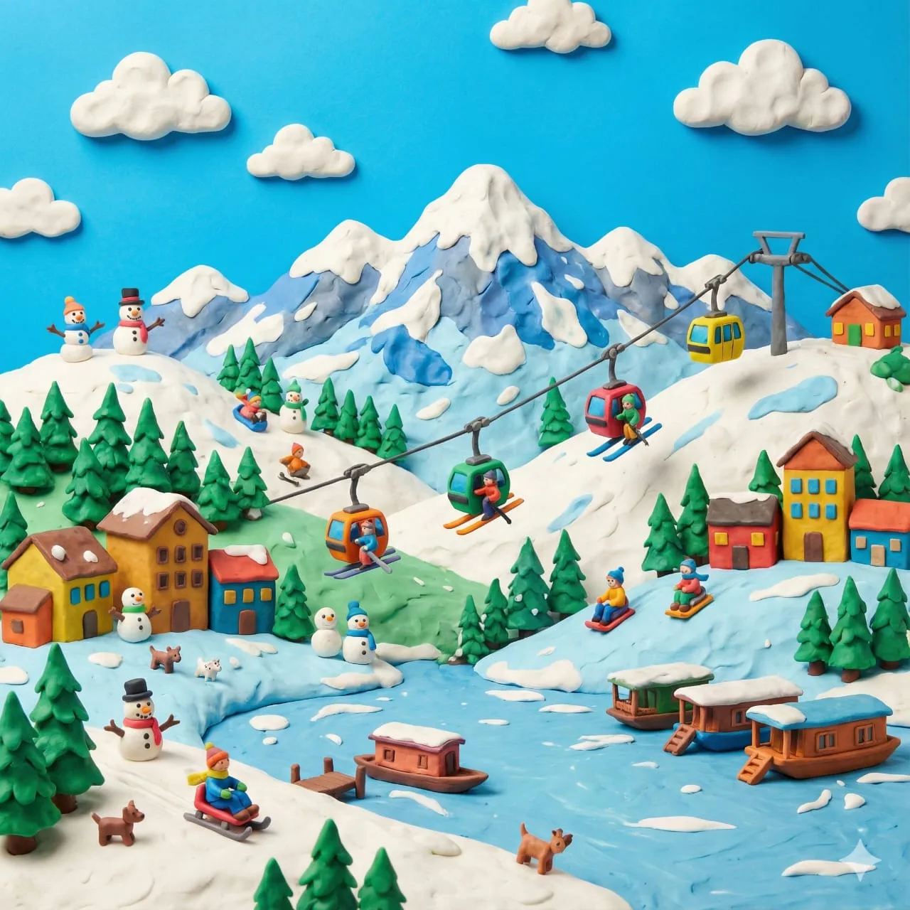

# Milo — by @Milo_Bahi_02

[← Back to Examples from X](../../EXAMPLES.md) · Category: Illustration & 3D · Model: `Nano Banana`

<a href="https://x.com/Milo_Bahi_02/status/2008765662488059907"></a>

Original post: **[@Milo_Bahi_02 on X](https://x.com/Milo_Bahi_02/status/2008765662488059907)** · Creator: [Milo](https://x.com/Milo_Bahi_02)

## Prompt

```text
8k Ultra-Realistic Promotional
Generate a whimsical miniature world featuring [KASHMIR SNOWFALL LAND MARK NAME] crafted entirely from colorful modeling clay. Every element buildings, trees, waterways, and urban features should appear hand  sculpted with visible fingerprints and organic clay textures. Use a playful, childlike style with vibrant colors: bright azure sky, puffy cream clouds, emerald trees, and buildings in warm yellows, oranges, reds, and blues.
The handmade quality should be evident in every surface and gentle curve. Capture from a wide perspective showcasing the entire miniature landscape in a harmonious, joyful composition. Include no text, words, or signage only sculptural clay elements that define the location through recognizable architectural features. 1080x1080 dimension.
```

## Try it

Paste the prompt into **[vinano.ai](https://vinano.ai?utm_source=github&utm_medium=readme&utm_campaign=awesome-image-video-prompts-updating&utm_content=x-page-try)** to generate your own version.

> The image and prompt belong to [@Milo_Bahi_02](https://x.com/Milo_Bahi_02) and are shown here with credit for reference. Creators can ask for changes or removal by opening an issue.
