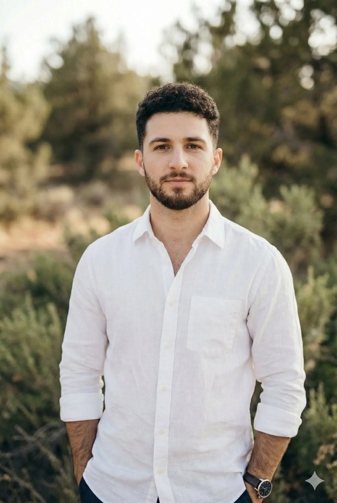

# Zara — by @ZaraIrahh

[← Back to Examples from X](../../EXAMPLES.md) · Category: Photography · Model: `Nano Banana`

<a href="https://x.com/ZaraIrahh/status/2008192606333988964"></a>

Original post: **[@ZaraIrahh on X](https://x.com/ZaraIrahh/status/2008192606333988964)** · Creator: [Zara](https://x.com/ZaraIrahh)

## Prompt

```text
{ "scene_type": "outdoor portrait", "composition": { "framing": "medium shot", "orientation": "vertical", "subject_position": "center-right", "pose": "arms crossed, body angled slightly to the right, head turned slightly left", "camera_angle": "eye-level", "depth_of_field": "shallow, strong background blur" }, "subject": { "gender_presentation": "male", "age_range": "mid-20s to early-30s", "skin_tone": "light", "facial_features": "defined jawline, light stubble beard, straight nose, soft cheek contours", "expression": "calm, contemplative, neutral confidence", "gaze_direction": " On camera" }, "hair": { "color": "medium brown", "style": "short to medium length, naturally curly with volume on top", "texture": "soft, slightly tousled" }, "wardrobe": { "top": { "type": "long-sleeve button-up shirt", "color": "white", "material": "lightweight linen or linen-blend", "fit": "relaxed, tailored", "details": "collarless or minimal collar, sleeves rolled to forearm" }, "accessories": { "watch": { "type": "analog wristwatch", "strap_color": "dark brown or black leather", "dial_color": "dark, likely black", "style": "classic, minimalist" } } }, "lighting": { "type": "natural daylight", "quality": "soft, diffused", "direction": "front-left", "contrast": "low to medium", "highlights": "gentle highlights on face and shirt", "shadows": "soft, minimal shadowing" }, "color_palette": { "dominant_colors": ["green", "white", "earth tones"], "background_tones": ["olive green", "forest green", "muted brown"], "overall_temperature": "warm-neutral" }, "background": { "environment": "natural landscape", "elements": ["green shrubs", "trees", "rock formations", "wild vegetation"], "focus": "heavily blurred (bokeh)", "mood": "serene, organic, outdoorsy" }, "artistic_style": { "genre": "lifestyle portrait photography", "aesthetic": "natural, clean, understated elegance", "mood": "calm, confident, introspective", "visual_story": "modern minimalist man in harmony with nature" }, "technical_traits": { "lens_effect": "portrait lens with background compression", "aperture_estimate": "wide (approximately f/1.8–f/2.8)", "sharpness": "high subject sharpness", "noise": "minimal", "post_processing": "light color correction, natural skin tones, subtle contrast enhancement" }, "typography": { "present": false } }
```

## Try it

Paste the prompt into **[vinano.ai](https://vinano.ai?utm_source=github&utm_medium=readme&utm_campaign=awesome-image-video-prompts-updating&utm_content=x-page-try)** to generate your own version.

> The image and prompt belong to [@ZaraIrahh](https://x.com/ZaraIrahh) and are shown here with credit for reference. Creators can ask for changes or removal by opening an issue.
