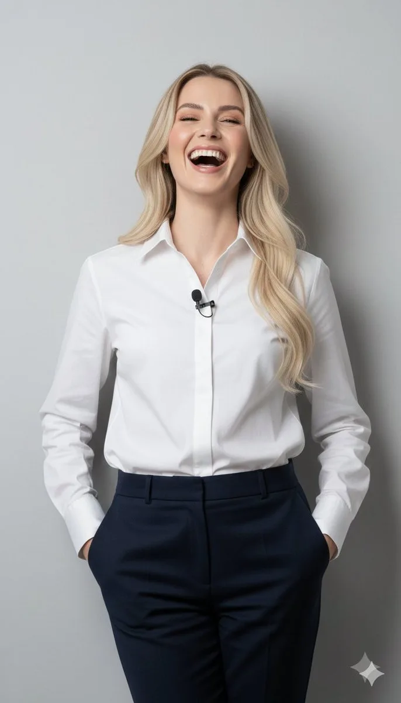

# Javeriya 🇺🇸 — by @JadoonKhan281

[← Back to Examples from X](../../EXAMPLES.md) · Category: Photography · Model: `Nano Banana`

<a href="https://x.com/JadoonKhan281/status/2018704062582297014"></a>

Original post: **[@JadoonKhan281 on X](https://x.com/JadoonKhan281/status/2018704062582297014)** · Creator: [Javeriya 🇺🇸](https://x.com/JadoonKhan281)

## Prompt

```text
{
  "action": "image_generation",
  "action_input": {
    "prompt": "A high-detail, 8K close-up portrait of the same woman from the previous images with the same facial features and long blonde wavy hair. She is captured in a moment of genuine, joyful laughter with her head slightly tilted back and eyes closed. She is wearing a crisp white button-down social shirt with a small black lapel microphone attached. The background is a minimalist, smooth light gray studio wall. The lighting is soft and professional, highlighting the texture of the fabric and the natural details of her expression. Cinematic quality, realistic skin textures, 2:3 aspect ratio.",
    "aspect_ratio": "2:3"
  }
}
```

## Try it

Paste the prompt into **[vinano.ai](https://vinano.ai?utm_source=github&utm_medium=readme&utm_campaign=awesome-image-video-prompts-updating&utm_content=x-page-try)** to generate your own version.

> The image and prompt belong to [@JadoonKhan281](https://x.com/JadoonKhan281) and are shown here with credit for reference. Creators can ask for changes or removal by opening an issue.
