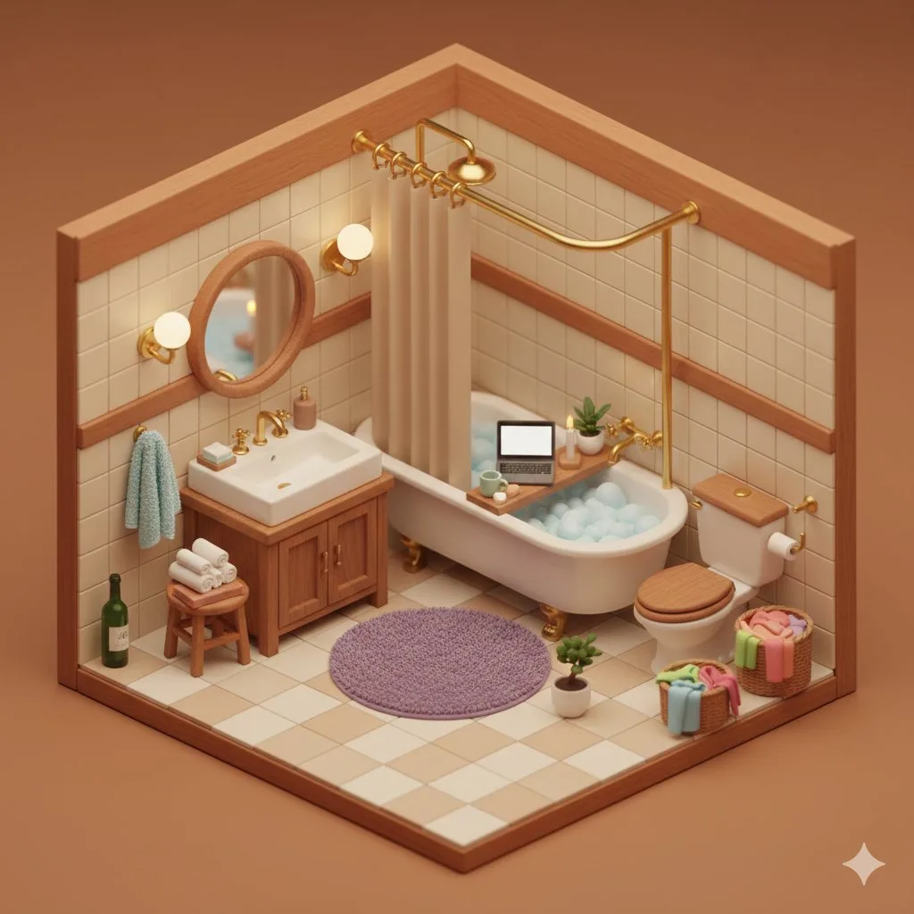

# Sharon Riley — by @Just_sharon7

[← Back to Community Examples](../../EXAMPLES.md) · Category: Illustration & 3D · Model: `Nano Banana`

<a href="https://x.com/Just_sharon7/status/2011801500541206983"></a>

Source: **[@Just_sharon7 on X](https://x.com/Just_sharon7/status/2011801500541206983)** · Creator: [Sharon Riley](https://x.com/Just_sharon7)

## Prompt

```text
{
  "prompt": "cute cozy isometric 3D miniature bathroom diorama, warm cozy aesthetic, detailed tiny room corner view, warm terracotta and beige color palette, small japanese-style bathroom scene, cream ceramic subway tiles with warm wooden trim, vintage clawfoot bathtub filled with blue bubbly foam, wooden bath tray across tub with open laptop, green mug, soap, candles, small potted plant, golden brass curved shower rod with beige shower curtain, round wooden mirror, white porcelain sink with wooden vanity cabinet, brass faucet, toilet with wooden seat, small wooden stool with rolled white towels and books, green wine bottle, tiny bonsai plant, wall mounted gold sconces with warm glowing bulbs, light blue fluffy towel hanging on wall hook, laundry basket with pink and orange clothes, wicker laundry hamper full of colorful towels, round plush purple bath mat, checkered beige-white floor tiles, small potted plant in white pot, cozy warm lighting, soft shadows, extremely detailed miniature dollhouse style, warm inviting atmosphere, soft bokeh, ken follett miniature aesthetic, tilt-shift effect, 8k, hyperdetailed, trending on artstation",
  "negative_prompt": "blurry, low quality, realistic scale, huge objects, people, human figures, text, watermark, logo, overexposed, underexposed, modern chrome, cold blue lighting, hospital style, empty room, cartoon, anime, 2D, sketch, painting, drawing",
  "aspect_ratio": "4:3",
  "style": "miniature diorama, isometric, cozy interior, warm tones, detailed product photography",
  "lighting": "soft warm golden hour lighting, cozy ambient glow, practical light sources from sconces",
  "camera_angle": "isometric 45 degree corner view, looking down into the room corner, miniature photography style",
  "quality_tags": "masterpiece, best quality, ultra detailed, 8k, sharp focus, intricate details",
  "additional_weights": {
    "miniature": 1.3,
    "diorama": 1.4,
    "isometric": 1.35,
    "cozy": 1.25,
    "warm lighting": 1.2,
    "detailed textures": 1.3
  }
}
```

## Try it

Paste the prompt into **[vinano.ai](https://vinano.ai?utm_source=github&utm_medium=readme&utm_campaign=awesome-image-video-prompts-updating&utm_content=x-page-try)** to generate your own version.

> The image and prompt belong to @Just_sharon7 ([original post](https://x.com/Just_sharon7/status/2011801500541206983)) and are shown here with credit for reference. Creators can ask for changes or removal by opening an issue.
