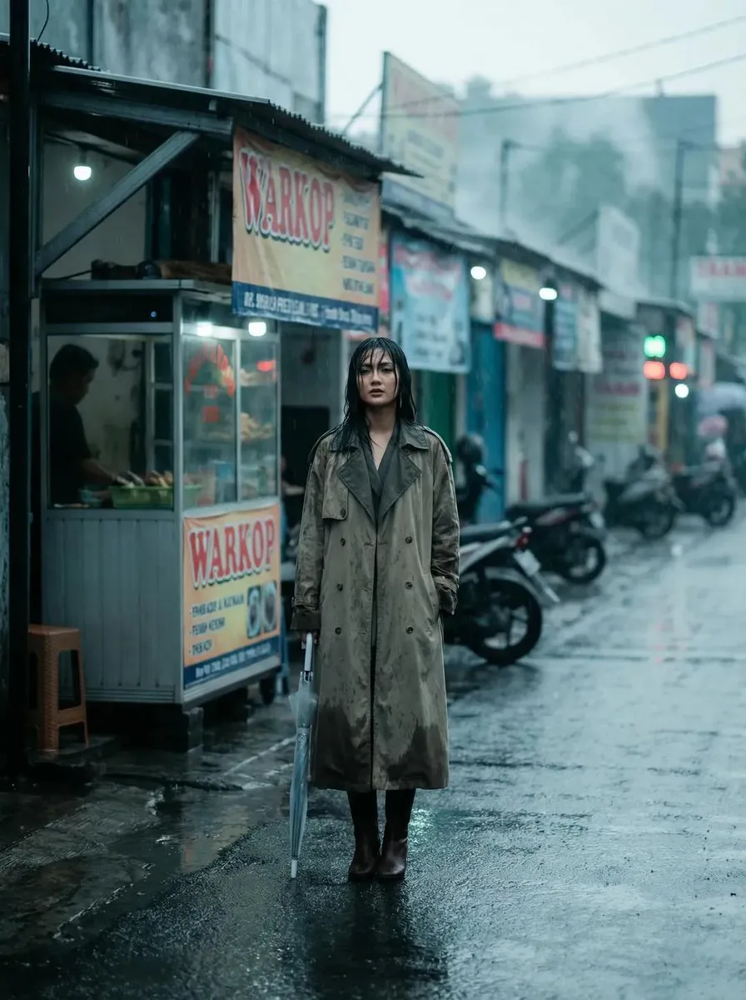

# K — by @ChillaiKalan__

[← Back to Examples from X](../../EXAMPLES.md) · Category: Photography · Model: `Nano Banana`

<a href="https://x.com/ChillaiKalan__/status/2028296737006170536"></a>

Original post: **[@ChillaiKalan__ on X](https://x.com/ChillaiKalan__/status/2028296737006170536)** · Creator: [K](https://x.com/ChillaiKalan__)

## Prompt

```text
Full body fashion editorial of a beautiful Indonesian woman, wet pavement outside warkop, soft rain blur background.
Canon R5, 85mm f/1.4
Overcast natural light
Cool-toned Portra LUT
Harmony: 70% documentary.
sRef: rainy street realism.
Hidden tokens: damp air texture, reflective asphalt.
```

## Try it

Paste the prompt into **[vinano.ai](https://vinano.ai?utm_source=github&utm_medium=readme&utm_campaign=awesome-image-video-prompts-updating&utm_content=x-page-try)** to generate your own version.

> The image and prompt belong to [@ChillaiKalan__](https://x.com/ChillaiKalan__) and are shown here with credit for reference. Creators can ask for changes or removal by opening an issue.
