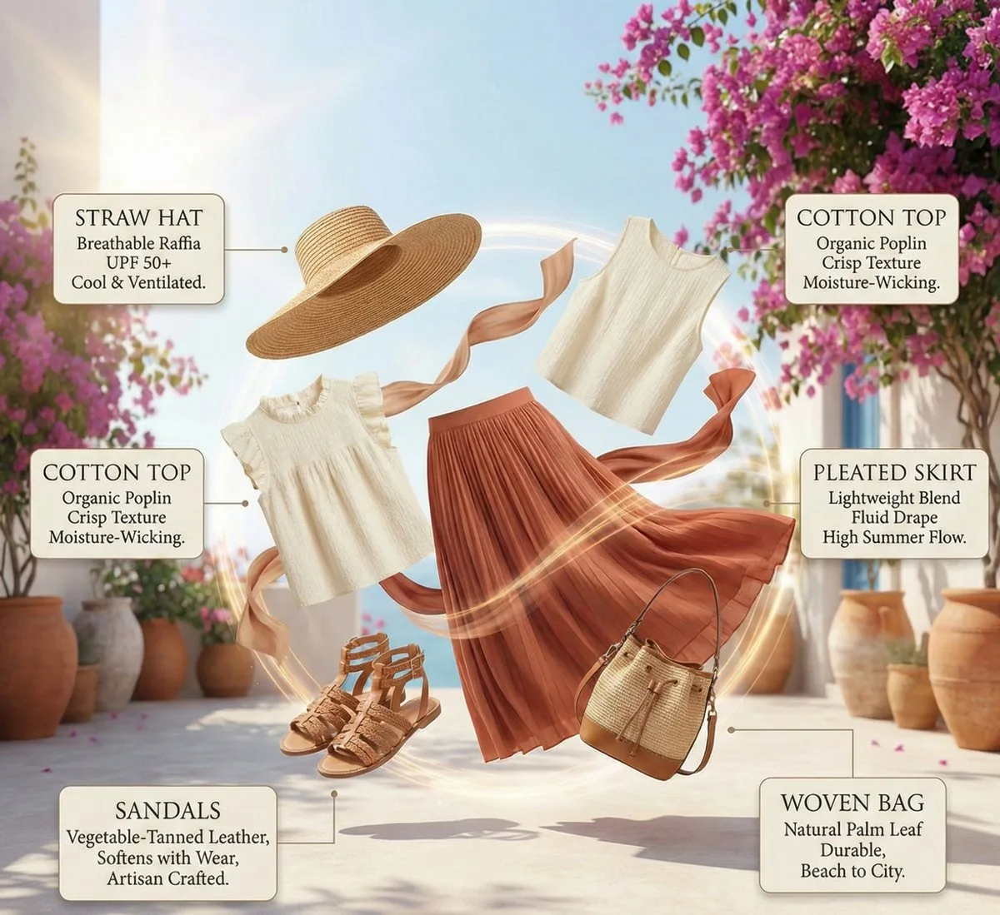

# Synthia — by @AIwithSynthia

[← Back to Community Examples](../../EXAMPLES.md) · Category: Product & Brand · Model: `Nano Banana`

<a href="https://x.com/AIwithSynthia/status/2017128891568312769"></a>

Source: **[@AIwithSynthia on X](https://x.com/AIwithSynthia/status/2017128891568312769)** · Creator: [Synthia](https://x.com/AIwithSynthia)

## Prompt

```text
High-fashion summer outfit infographic with color-coordinated floating elements arranged in an elegant exploded circular composition, featuring a breathable straw hat, sleeveless organic cotton top, fluid pleated skirt, artisan leather sandals, and a woven palm-leaf bag; refined callouts highlight fabric breathability, crisp texture, moisture-wicking, and seasonal comfort, with warm neutral tones of ivory, terracotta, sand, and soft tan; subtle motion trails and airy fabric swirls suggest a gentle summer breeze, bright natural sunlight creates soft shadows and a sun-kissed glow, Mediterranean gemini lifestyle mood, premium editorial aesthetic, ultra-sharp details, minimal typography, luxury fashion magazine infographic style, Instagram-ready
```

## Try it

Paste the prompt into **[vinano.ai](https://vinano.ai?utm_source=github&utm_medium=readme&utm_campaign=awesome-image-video-prompts-updating&utm_content=x-page-try)** to generate your own version.

> The image and prompt belong to @AIwithSynthia ([original post](https://x.com/AIwithSynthia/status/2017128891568312769)) and are shown here with credit for reference. Creators can ask for changes or removal by opening an issue.
