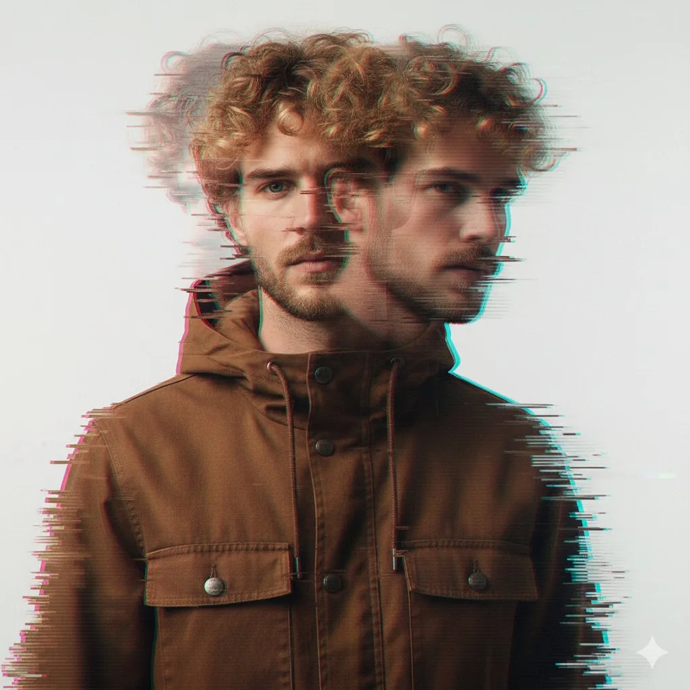

# Aijaz — by @iamsofiaijaz

[← Back to Community Examples](../../EXAMPLES.md) · Category: Photography · Model: `Nano Banana`

<a href="https://x.com/iamsofiaijaz/status/2023643232845140297"></a>

Source: **[@iamsofiaijaz on X](https://x.com/iamsofiaijaz/status/2023643232845140297)** · Creator: [Aijaz](https://x.com/iamsofiaijaz)

## Prompt

```text
A double exposure, long exposure editorial photograph of a man Use image for face reference in a brown hooded utility jacket with sharp facial features and curly blonde hair. Apply a digital glitch distortion effect with chromatic aberration (cyan and magenta color fringing), horizontal scan lines, and pixel sorting across the motion trails. Clean white backdrop, cinematic lighting, 35mm lens, high resolution, muted natural colors with tech-inspired digital artifacts."
```

## Try it

Paste the prompt into **[vinano.ai](https://vinano.ai?utm_source=github&utm_medium=readme&utm_campaign=awesome-image-video-prompts-updating&utm_content=x-page-try)** to generate your own version.

> The image and prompt belong to @iamsofiaijaz ([original post](https://x.com/iamsofiaijaz/status/2023643232845140297)) and are shown here with credit for reference. Creators can ask for changes or removal by opening an issue.
