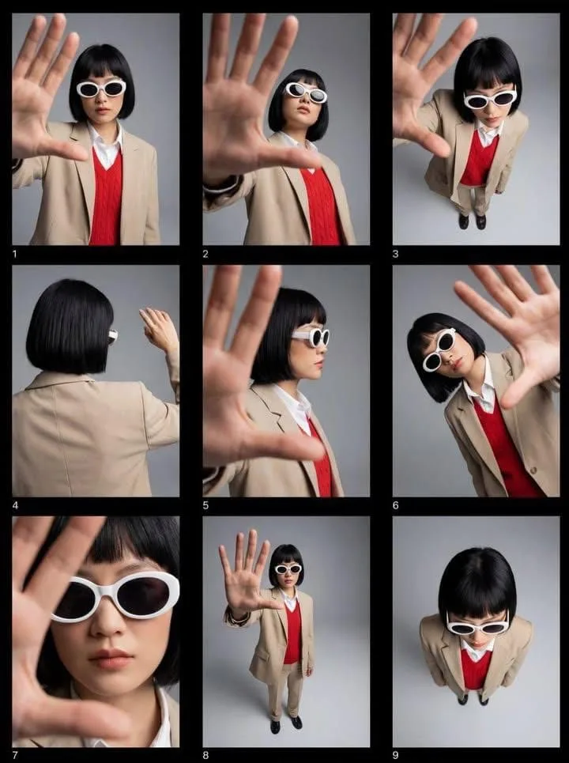

# Kashberg — by @Kashberg_0

[← Back to Community Examples](../../EXAMPLES.md) · Category: Photography · Model: `Nano Banana`

<a href="https://x.com/Kashberg_0/status/2018544770440925209"></a>

Source: **[@Kashberg_0 on X](https://x.com/Kashberg_0/status/2018544770440925209)** · Creator: [Kashberg](https://x.com/Kashberg_0)

## Prompt

```text
Editorial fashion contact sheet of a modern woman with a sharp black bob haircut wearing white oval sunglasses, a beige tailored suit over a red sweater vest and white shirt, photographed in a minimalist studio with a neutral grey backdrop. Multiple frames arranged in a 3×3 grid showing varied angles—front, side, top-down, back view—while the subject repeatedly reaches her hand toward the camera lens, creating strong depth and perspective distortion. Clean high-fashion styling, bold color contrast, soft diffused studio lighting, crisp focus, contemporary magazine aesthetic, 35mm–50mm look, ultra-sharp, high resolution.
```

## Try it

Paste the prompt into **[vinano.ai](https://vinano.ai?utm_source=github&utm_medium=readme&utm_campaign=awesome-image-video-prompts-updating&utm_content=x-page-try)** to generate your own version.

> The image and prompt belong to @Kashberg_0 ([original post](https://x.com/Kashberg_0/status/2018544770440925209)) and are shown here with credit for reference. Creators can ask for changes or removal by opening an issue.
